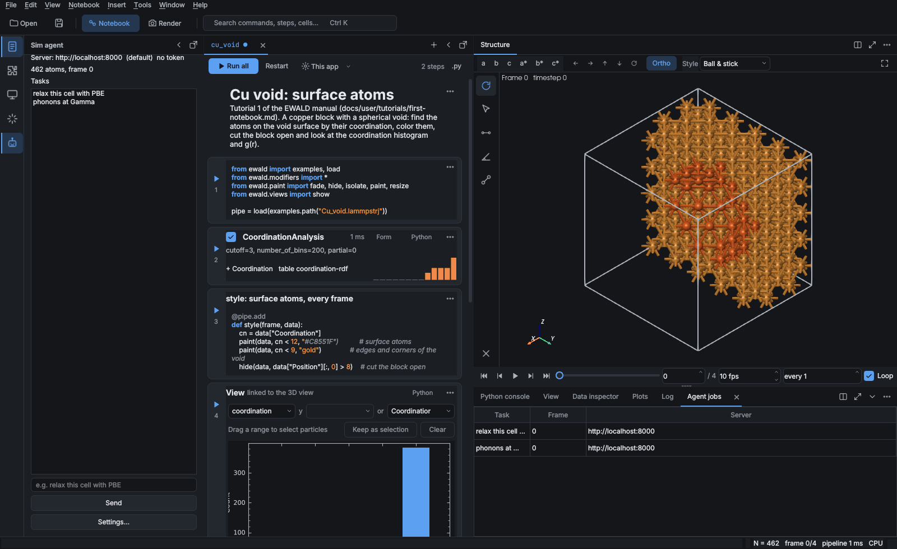

# Side bar plugins

A plugin can add to the desktop app itself: a **side bar** with its own button on the activity
bar (the icon column at the left edge, under Notebook, Plugins, Remotes and AI chat), a **tab
under the 3D view**, **menu entries** (in the menu bar or the 3D view's right-click menu) and a
**page in Preferences** for its settings. Installing the plugin is all a user does; switching
it off in the Plugins side bar removes all of them again.

[`examples/plugins/sim_agent_panel.py`](https://github.com/frssp/ewald/blob/main/examples/plugins/sim_agent_panel.py) is a complete
one-file example: a "Sim agent" side bar that follows the structure on screen and turns tasks
into notebook cells, an "Agent jobs" tab listing the tasks sent, Tools › Sim agent and a
"Send picked atoms to Sim agent" entry in the 3D view's right-click menu, and a "Sim agent"
Preferences page with its server, token and model.



## A side bar: `@panel`

```python
from ewald.plugin_api import panel


@panel(title="Sim agent", icon="sim-agent.svg", shortcut="Ctrl+Alt+A", width=320)
def sim_agent(context):
    """Send simulation tasks to an agent."""      # the button's tooltip
    from PySide6 import QtWidgets

    label = QtWidgets.QLabel("No structure loaded")
    context.on("data", lambda data: label.setText(f"{data.count} atoms, frame {context.frame}"))
    return label
```

The function returns a `QWidget` (PySide6) and is called the first time the user opens the side
bar, not at start, so a plugin's Qt code costs nothing until then; import PySide6 inside it, so
the plugin still loads in scripts and on machines without the GUI. If it raises, the side bar
shows the traceback and the rest of the window carries on.

| Argument | Meaning |
|---|---|
| `title` | the button's and the side bar's name (default: `name`, the function name) |
| `icon` | a built-in icon name (`"chart"`, `"plugins"`, ...), an SVG or PNG file next to the plugin file, or SVG markup (`"<svg ...>"`, handy for one-file plugins). Draw SVGs on a 24 px grid with `stroke="currentColor"`: they then take the UI theme's colors like the built-in buttons |
| `shortcut` | a key sequence such as `"Ctrl+Alt+A"`, on the entry under Window › Plugin panels |
| `width` | starting width in pixels |
| `tooltip`, `description` | the button's tooltip (default: the docstring's first paragraph) |
| `area` | `"side"` (default) for a side bar, `"bottom"` for a [tab under the 3D view](#a-tab-under-the-3d-view) |

The side bar opens in a column of its own left of the notebook, like the AI chat, and can be
dragged, floated and folded like the other side bars. Window › Plugin panels lists every plugin
side bar, and so does the command palette (Ctrl+K). A side bar that is open when the app closes
opens again at the next start, where it was and as wide as it was (with Preferences › General ›
*Restore window layout*); that is the first time its function runs in that session.

### A tab under the 3D view

With `area="bottom"` the panel is a tab next to Python console, View, Data inspector, Plots and
Log instead of a side bar. It has no activity-bar button; Window › Plugin panels opens it. Like
the other tabs it can be dragged to another group or split beside the 3D view, and it has a
close button; closing it deletes the widget, and the next open builds a new one. An open tab is
part of the saved layout.

```python
@panel(title="Agent jobs", icon="send", area="bottom")
def agent_jobs(context):
    from PySide6 import QtWidgets

    return QtWidgets.QTableWidget(0, 3)
```

### The context

`context` is what the side bar knows about the window:

| | |
|---|---|
| `context.settings` | ewald's preferences (`context.settings["viewport.projection"]`) |
| `context.plugin_settings(name)` | the values of a [settings page](settings.md), e.g. the plugin's own |
| `context.pipeline` | the pipeline of the notebook on screen (`pipe` in its cells), or None |
| `context.data` | the computed frame the 3D view shows (a `DataCollection`), or None |
| `context.frame` | the frame number on the timeline |
| `context.picks` | indices of the atoms picked in the 3D view (an empty list when none are) |
| `context.message(text, error=False)` | a line in the status bar and the Log |
| `context.open_preferences(page)` | open Preferences at a page, e.g. the plugin's own |
| `context.insert_cell(code)` | add a code cell after the current one, without running it |
| `context.add_step(modifier)` | add a step cell and compute it |
| `context.on(event, callback)` | `"data"` after each computed frame (`callback(data)`), `"pipeline"` when another pipeline is loaded (`callback(pipeline)`), `"settings"` after Preferences are applied, plugin pages included (`callback(settings)`) |

These keep their meaning while `PLUGIN_API` stays the same. `context.window` is the main window
itself, for anything else; it is internal and may change in any release.

## Menu entries: `@menu_item`

```python
from ewald.plugin_api import menu_item


@menu_item(title="Send picked atoms to Sim agent", menu="3D view", when="picks", icon="send")
def send_picked(context):
    """Send a relaxation task for the picked atoms."""     # the tooltip
    context.message(f"sending atoms {context.picks}")


@menu_item(title="Settings…", menu="Tools/Sim agent")
def agent_settings(context):
    context.open_preferences("Sim agent")
```

The function is called with the same `context` a panel gets when the user picks the entry; an
exception goes to the status bar and the Log.

| Argument | Meaning |
|---|---|
| `title` | the entry's text (default: the function name) |
| `menu` | `"File"`, `"Edit"`, `"View"`, `"Notebook"`, `"Insert"`, `"Tools"` (default), `"Window"`, `"Help"`, or `"3D view"` for the right-click menu of the 3D view; a `/` adds a submenu, as in `"Tools/Sim agent"` |
| `when` | `""` (always), `"data"` (a structure is loaded) or `"picks"` (atoms are picked). In the menu bar the entry is greyed out until then; in the 3D view's menu it is left out |
| `shortcut` | a key sequence such as `"Ctrl+Alt+P"` |
| `icon` | as for `@panel` |
| `description` | the tooltip (default: the docstring's first paragraph) |

Plugin entries come after a separator at the end of their menu, in the order the plugins
registered them; in the 3D view's menu they sit above *Ask AI about selection…*.

## Its settings

A side bar's plugin usually needs some setting up (a server, a token). Give it a
[settings page](settings.md): it becomes a page of Preferences with the side bar's icon, and
the panel reads it with `context.plugin_settings(name)` (or `plugin_settings(name)` from
`ewald.plugin_api`), re-reading after `context.on("settings", ...)` fires:

```python
from ewald.plugin_api import SettingsField, panel, settings_page


@settings_page("sim-agent", title="Sim agent", fields=[
    SettingsField("server", "Server", default="http://localhost:8000"),
    SettingsField("token", "Access token", kind="secret")])
class SimAgentSettings:
    """The agent behind the Sim agent side bar."""     # ewald stores the values


@panel(title="Sim agent")
def sim_agent(context):
    from PySide6 import QtWidgets

    label = QtWidgets.QLabel()
    show = lambda *_: label.setText(context.plugin_settings("sim-agent")["server"])
    context.on("settings", show)
    show()
    return label
```

A Settings… button in the panel can open the page with `context.open_preferences("Sim agent")`.

## Shipping it

In a one-file plugin both registrations sit at the top level of the file, as in the example. A
package lists them as entry points instead. An entry point gives only a name, so the panel
function carries `title`, `icon`, `tooltip`, `shortcut` and `width` as attributes
(`sim_agent.title = "Sim agent"`), and the settings class carries `title` and `fields` as class
attributes rather than the decorator ([Settings pages](settings.md)):

```toml
[project.entry-points."ewald.panels"]
sim_agent = "ewald_sim_agent.gui:sim_agent"

[project.entry-points."ewald.menu_items"]
send_picked = "ewald_sim_agent.gui:send_picked"     # set .title, .menu, .when on the function

[project.entry-points."ewald.settings_pages"]
sim-agent = "ewald_sim_agent.gui:SimAgentSettings"

[project.entry-points."ewald.plugins"]
sim-agent = "ewald_sim_agent"
```

`ewald plugins` lists panels, menu items and settings pages next to the other contributions,
and the Plugins side bar shows them as `panel`, `menu_item` and `settings_page`. Like every plugin, a GUI plugin runs
in ewald's own process with the user's rights; the plugins bundled in a received `.ewd` are not
imported until the notebook is trusted.
