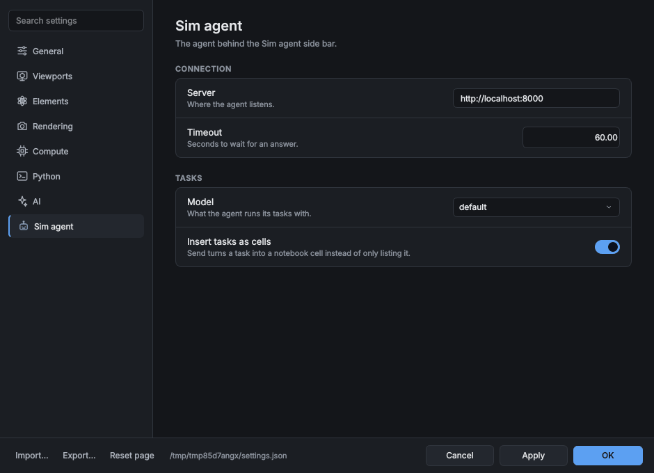

# GUI plugins: side bars and Preferences pages

A plugin can add to the desktop app itself: a **side bar** with its own button on the activity
bar (the icon column at the left edge, under Notebook, Plugins, Remotes and AI chat), and a
**page in Preferences** for its settings. Installing the plugin is all a user does; switching
it off in the Plugins side bar removes both again.

[`examples/plugins/sim_agent_panel.py`](https://github.com/frssp/ewald/blob/main/examples/plugins/sim_agent_panel.py) is a complete
one-file example: a "Sim agent" side bar that follows the structure on screen and turns tasks
into notebook cells, and a "Sim agent" Preferences page with its server, model and timeout.


## A side bar: `@panel`

```python
from ewald.plugin_api import panel


@panel(title="Sim agent", icon="sim-agent.svg", shortcut="Ctrl+Alt+A", width=320)
def sim_agent(context):
    """Send simulation tasks to an agent."""      # the button's tooltip
    from PySide6 import QtWidgets

    label = QtWidgets.QLabel("No structure loaded")
    context.on("data", lambda data: label.setText(f"{data.count} atoms, frame {context.frame}"))
    return label
```

The function returns a `QWidget` (PySide6) and is called the first time the user opens the side
bar, not at start, so a plugin's Qt code costs nothing until then; import PySide6 inside it, so
the plugin still loads in scripts and on machines without the GUI. If it raises, the side bar
shows the traceback and the rest of the window carries on.

| Argument | Meaning |
|---|---|
| `title` | the button's and the side bar's name (default: `name`, the function name) |
| `icon` | a built-in icon name (`"chart"`, `"plugins"`, ...), an SVG or PNG file next to the plugin file, or SVG markup (`"<svg ...>"`, handy for one-file plugins). Draw SVGs on a 24 px grid with `stroke="currentColor"`: they then take the UI theme's colors like the built-in buttons |
| `shortcut` | a key sequence such as `"Ctrl+Alt+A"`, on the entry under Window › Plugin panels |
| `width` | starting width in pixels |
| `tooltip`, `description` | the button's tooltip (default: the docstring's first paragraph) |

The side bar opens in a column of its own left of the notebook, like the AI chat, and can be
dragged, floated and folded like the other side bars. Window › Plugin panels lists every plugin
side bar, and so does the command palette (Ctrl+K).

### The context

`context` is what the side bar knows about the window:

| | |
|---|---|
| `context.settings` | the user's preferences, including the plugin's own page: `context.settings["simagent.server"]` |
| `context.pipeline` | the pipeline of the notebook on screen (`pipe` in its cells), or None |
| `context.data` | the computed frame the 3D view shows (a `DataCollection`), or None |
| `context.frame` | the frame number on the timeline |
| `context.message(text, error=False)` | a line in the status bar and the Log |
| `context.open_preferences(page)` | open Preferences at a page, e.g. the plugin's own |
| `context.insert_cell(code)` | add a code cell after the current one, without running it |
| `context.add_step(modifier)` | add a step cell and compute it |
| `context.on(event, callback)` | `"data"` after each computed frame (`callback(data)`), `"pipeline"` when another pipeline is loaded (`callback(pipeline)`), `"settings"` after Preferences are applied (`callback(settings)`) |

These keep their meaning while `PLUGIN_API` stays the same. `context.window` is the main window
itself, for anything else; it is internal and may change in any release.

## A Preferences page: `settings_page`

```python
from ewald.plugin_api import Option, settings_page

settings_page("Sim agent", [
    Option("simagent.server", "http://localhost:8000", "Server", "Where the agent listens."),
    Option("simagent.model", "default", "Model", choices=("default", "fast", "accurate")),
    Option("simagent.timeout", 60.0, "Timeout", "Seconds to wait.", minimum=1, maximum=3600),
    Option("simagent.insert_cells", True, "Insert tasks as cells"),
], description="The agent behind the Sim agent side bar.",
   sections=[("Connection", ["simagent.server", "simagent.timeout"]),
             ("Tasks", ["simagent.model", "simagent.insert_cells"])])
```



Each `Option` is a row, built from its default like ewald's own: a toggle for `True`/`False`, a
number field with `minimum`/`maximum`, a combo box for `choices`, a text field otherwise, and
`kind="color"`, `"file"` or `"dir"` for a color button or a path field. Every key starts with a
prefix of the plugin's own (`simagent.`); ewald's own prefixes (`general`, `viewport`, `llm`,
...) and one already taken by another plugin are refused. Without `sections` the page has one
section named after it; `icon` takes the same values as a panel's.

The values are stored in `settings.json` with ewald's own (only those that differ from the
default) and get everything the other rows have: the changed dot, Reset, Reset page, search
and Import/Export. They are kept while the plugin is switched off or uninstalled, so turning it
back on brings them back. Read them anywhere:

```python
from ewald import settings

settings.load()["simagent.server"]
```

Scripts and `compute()` never read settings on their own, so a plugin's analysis code takes its
values as arguments; the side bar passes them in.

## Shipping it

In a one-file plugin both registrations sit at the top level of the file, as in the example. A
package lists its panel as an entry point and calls `settings_page` when its module is imported
(for example from the module that defines the panel):

```toml
[project.entry-points."ewald.panels"]
sim_agent = "ewald_sim_agent.gui:sim_agent"

[project.entry-points."ewald.plugins"]
sim-agent = "ewald_sim_agent"
```

`ewald plugins` lists panels and settings pages next to the other contributions, and the
Plugins side bar shows them as `panel` and `settings_page`. Like every plugin, a GUI plugin runs
in ewald's own process with the user's rights; the plugins bundled in a received `.ewd` are not
imported until the notebook is trusted.
