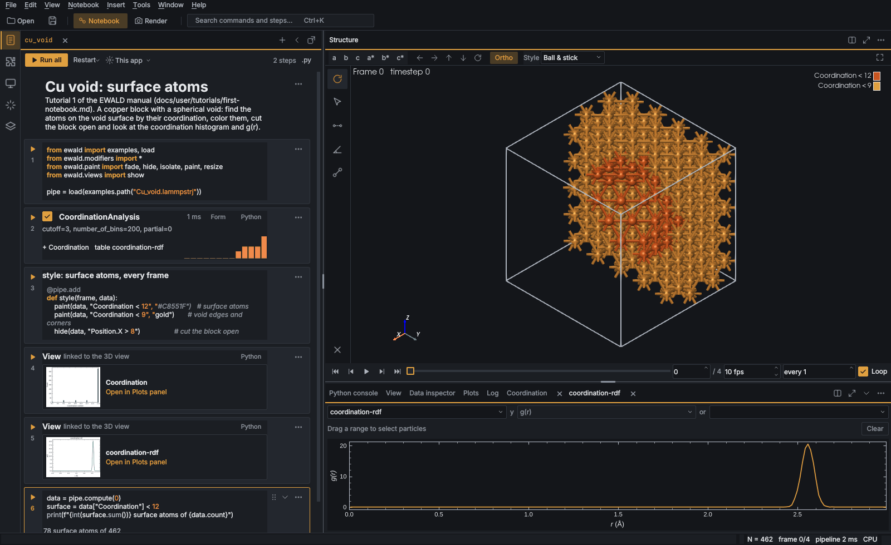

# Color maps and themes

Two small kinds of plugin change how a figure looks without drawing anything new: a color map
(numbers to colors) and a theme (element colors, background, cell color and radius preset under
one name).

## Color maps

Every place ewald maps numbers to colors takes a color map name: `ColorCoding(cmap=...)`,
`GridSlice(cmap=...)`, `VectorVis(cmap=...)`, the color legend of every renderer and the GUI's
`cmap` drop-down. Any matplotlib name works, and so does a registered plugin:

```python
# <config dir>/plugins/maps.py
from ewald.plugin_api import colormap


@colormap(kind="diverging", description="blue-white-red for charge differences")
def charge_difference():
    return ["#2166ac", "#92c5de", "#f7f7f7", "#f4a582", "#b2182b"]
```

The function returns a list of colors (names, hex or RGB(A) in 0..1, spaced evenly from 0 to 1),
an (n, 3|4) array, or a matplotlib `Colormap`; it runs once, the first time the map is used.
`register_colormap("name", colors)` registers data directly, and an installed package uses the
`ewald.colormaps` entry point group. `kind` is `sequential`, `diverging`, `cyclic` or
`categorical`. Appending `_r` to a plugin name reverses it, as for matplotlib maps.

```python
from ewald.modifiers import ColorCoding

pipe.modifiers.append(ColorCoding("Charge", cmap="charge_difference"))
```

`ewald.colormaps.get_colormap(name)` resolves a name to a matplotlib `Colormap`, so plugin
code that colors things itself should call it instead of `matplotlib.colormaps[...]`.

### Grayscale check

`ewald.colormaps.is_perceptual(name, kind)` checks that CIELAB lightness changes monotonically
along the map (on each side of the middle for diverging maps), which is what keeps a figure
readable in grayscale print and for most color-blind readers; `lightness(name)` returns the L*
curve. The GUI's color map drop-down shows a preview strip and this verdict as a tooltip, and the
AI tool `list_styles` reports it as `grayscale_safe`.

## Themes

A theme sets element colors (a base scheme plus overrides, optionally muted toward gray),
background, cell color and radius preset. Built-in themes:

| Theme | What it sets |
|---|---|
| `Default` | Jmol element colors and covalent radii (ewald's defaults) |
| `VESTA` | VESTA's element colors on white |
| `CPK` | CPK element colors |
| `Journal` | Jmol colors muted 35% toward gray, white background, dark gray cell |
| `ASE` | ASE's GUI: Jmol colors and covalent radii on white, black cell (pair with `atom_style="flat"`) |
| `Dark slide` | Jmol colors on black, light cell lines |

```python
render(data, "figure.png", theme="VESTA")
render(data, "slide.png", theme="Dark slide", type_colors={"Li": "#c080ff"})   # explicit settings win
```

On the command line it is `--theme VESTA`; in the GUI, View › Structure theme. The GUI copies the theme's
values into the view style, so a session keeps them even where the theme plugin is not installed.

A theme plugin returns a `Theme`:

```python
from ewald.plugin_api import Theme, theme


@theme(name="Group style")
def group_style():
    """VESTA colors, Li purple, on white with a gray cell."""
    return Theme(base="VESTA", colors={"Li": "#7f3fbf"}, background="white", cell_color="#555555")
```

| `Theme` field | Meaning |
|---|---|
| `base` | element color scheme underneath: `Jmol`, `CPK` or `VESTA` |
| `colors` | per element or per particle type, on top of `base` |
| `mute` | 0..1, how far colors move toward the gray of the same lightness |
| `background`, `cell_color`, `radius_preset` | None leaves the setting alone |

Particle types map to elements the way the rest of ewald maps them (`Fe3+` uses Fe); types the
theme does not know keep their default colors. An installed package registers themes under the
`ewald.themes` entry point group, and a plugin cannot take a built-in theme's name.

`examples/plugins/figure_extras.py` holds both examples above and an overlay.

## UI themes

A UI theme colors the desktop app itself: panels, text, buttons, the notebook, plots, the
Python console and the code editor. It is separate from the figure themes above, which color atoms
and rendered images. ewald ships Graphite (dark, the default), Paper (light), Midnight (dark blue),
Solarized light, Solarized dark and High contrast (white, black text and borders); a `@ui_theme`
plugin returns the design tokens it changes, and every token it leaves out comes from its `base`
palette (any built-in theme).

```python
from ewald.plugin_api import ui_theme


@ui_theme(name="Nord", base="graphite")
def nord():
    """Polar-night panels with frost-blue accents."""
    return {"bg": "#2E3440", "panel": "#323946", "accent": "#88C0D0", "on_accent": "#2E3440"}
```

| Token | Where it shows |
|---|---|
| `bg`, `panel`, `raised`, `border` | window background, panels, cards and inputs, lines between them |
| `text`, `secondary`, `muted` | main text, secondary labels, hints |
| `accent`, `on_accent`, `accent_soft` | what you can act on (buttons, links, focus), text on it, its tint |
| `data`, `data_soft` | results computed from the data (plots, readouts) |
| `selection`, `pick` | selected atoms, picked atoms |
| `error`, `ok` | error and success messages |
| `hover`, `pressed`, `accent_hover`, `accent_pressed` | button and row shades under the mouse and while pressed; left out, they are mixed from `raised`/`accent` toward `text` |
| `viewport` | the 3D view background (unless Preferences › 3D view › *Background follows the UI theme* is off) |

Values are `#rrggbb` colors. Pick the theme under Preferences › General › *UI theme*; panels,
the console and open plots switch at once (saved figures keep print colors). A theme with an
unknown token, a color that is not `#rrggbb` or a base that is not a built-in theme is reported
in the log and the app falls back to Graphite rather than failing to open. An installed package registers UI themes under the `ewald.ui_themes` entry
point group (an object that is a dict of tokens, which may name its `"base"`, or a function
returning one), and a plugin cannot take the name of a built-in theme.

### Beyond colors

Next to its color tokens a UI theme may set how the app is drawn. Every key is optional:

```python
@ui_theme(name="Studio", base="graphite")
def studio():
    """Compact and square."""
    return {
        "accent": "#E0A040",
        "font": "Inter", "mono_font": "Fira Code", "font_size": 12,
        "radius": 2, "density": "compact", "icon_stroke": 1.4,
        "qss": "QWidget#panelHeader { border-bottom: 2px solid $accent; }",
    }
```

| Key | Effect | Default |
|---|---|---|
| `font` | the UI font, tried before ewald's (IBM Plex Sans, then the system font) | `""` |
| `mono_font` | the font of the code editor, console and paths | `""` |
| `font_size` | UI text size in px (1-30); applies while Preferences › General › *Font size* is left at its default | `0` (ewald's) |
| `radius` | corner radius of buttons, inputs and cards in px (0-16); rounder shapes such as pills keep theirs | `6` |
| `density` | spacing inside widgets: `"compact"`, `"normal"` or `"comfortable"` | `"normal"` |
| `icon_stroke` | line width of the built-in icons (0.8-3.0, on their 24 px grid) | `1.7` |
| `qss` | extra [Qt style sheet](https://doc.qt.io/qt-6/stylesheet-reference.html) rules, added after ewald's so they win; `$accent`, `$panel`, ... are this theme's colors | `""` |

A font that is not installed falls back to ewald's. Style rules address widgets by the object
names in `ewald/gui/theme.py` (`panelHeader`, `headerButton`, `chatStarter`, ...); those names
are not part of `PLUGIN_API` and may change between releases. A key with a bad value is reported
in the log and that theme then uses the default fonts and sizes, keeping its colors. Code editors
that are already open keep their font until they are reopened.



`examples/plugins/ui_themes.py` holds Nord (dark), Sepia (light) and Studio (compact, square).
