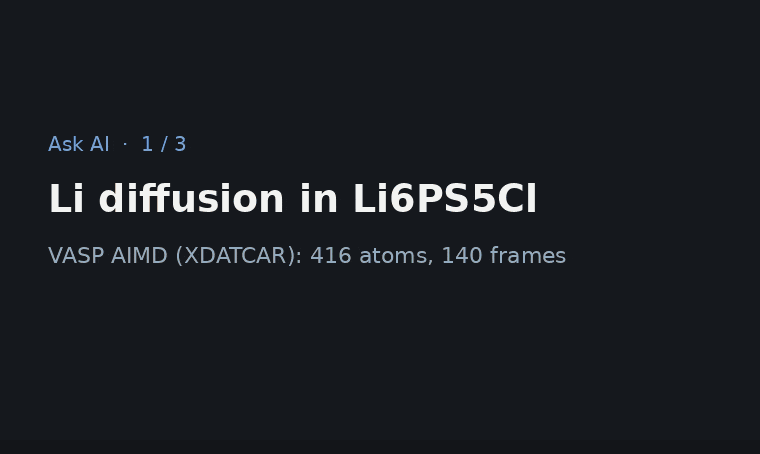

# AI integration

`ewald.llm` exposes the pipeline to an AI model as tools, so an analysis can be asked for in
words and still ends up as an ordinary, reproducible pipeline. Claude is the default; OpenAI,
Google Gemini, a model on your own machine (Ollama, LM Studio) or any other OpenAI-compatible
server work the same way (see [Providers](#providers)). Every tool, what it may change and everything
that is sent to the provider are listed in [What the AI may do and what it sees](ai-permissions.md).



In the window, the AI chat side bar (Ctrl+J) works on the notebook beside it: with Preferences ›
AI › "Let the AI run cells" on, the AI adds steps, writes and edits cells and runs them, and each
answer links the cells it touched. (The recording's model answers are scripted, see
`docs/images/make_ai_demo.py`; the tools and cells are real.)

```bash
pip install -e ".[llm]"
export ANTHROPIC_API_KEY=...          # or: ant auth login, or Preferences › AI in the GUI
```

```python
from ewald.llm import Agent

agent = Agent.from_file("XDATCAR")
print(agent.ask("What happens in this run? Render the frame where it changes."))
print(agent.toolset.to_script())      # the session notebook as a standalone Python script

agent = Agent.from_file("XDATCAR", provider="openai")                       # OPENAI_API_KEY
agent = Agent.from_file("XDATCAR", provider="openai-compatible", model="qwen2.5",
                        base_url="http://localhost:11434/v1")              # Ollama, no key
```

The model never reads raw coordinates. The tools return compact descriptors (composition, cell,
density, minimum distance, coordination histograms, g(r) peaks, sanity warnings), and
`describe_trajectory` flags the frames where a descriptor jumps. Renders come back as images
the model can look at. The tools are: `load_structure`, `describe_frame`,
`describe_trajectory`, `event_details`, `list_modifiers`, `add_modifier`, `remove_modifier`,
`show_pipeline`, `set_frame`, `evaluate_expression`, `compute_rdf`, `analyze_symmetry`,
`compute_diffraction`, `compute_msd` (time per frame from the run's input files), `check_run` (what the run is and
whether it converged and equilibrated; see [Runs](runs.md)),
`describe_selection`,
`get_view` and `set_view` (every display setting of the Structure view, the same ones as the notebook's
`view(pipe, ...)` cell: style, colors, radii, bonds, cell, background, boundary, camera, frame and
picture options; in the GUI the viewport follows them), `render_image` (drawn with those settings;
its own arguments, `theme` among them, are for that one picture), `list_visuals`, `add_visual`,
`remove_visual` (visual element plugins in the view), `list_overlays`, `add_overlay`, `remove_overlay`
(overlays such as the coordinate tripod), `list_styles` (themes and color maps, each marked
whether it reads in grayscale), `export_file`, `get_script` and `python_api` (the API reference
for writing cells: the notebook's cell kinds, `show`/`view`/`paint`, every modifier and the modifier plugins
installed here; the model is told to read it before it writes Python). Plugins add their own tools with
`@ai_tool` (also spelled `@claude_tool`; [AI tool plugins](../plugins/tools.md)); the ewald-plumed plugin adds
`compute_plumed_cvs` and `read_plumed_output` ([PLUMED](plumed.md)).

## Only through the notebook

The AI changes the structure, the view and every other result only by running notebook cells,
so the notebook alone always reproduces what it did. The tools work on a notebook: in the GUI
the current tab, in Python the one you pass (`notebook=`), otherwise a session notebook of the
toolset's own (`agent.toolset.notebook`). Each tool that changes something writes a cell and
runs it:

| Tool | Cell |
| --- | --- |
| `load_structure` | `pipe = load('XDATCAR')` at the end |
| `add_modifier` | a step cell `pipe.add(CoordinationAnalysis(cutoff=3.0))`, at the end or before the step at `index` |
| `remove_modifier` | deletes that step cell |
| `set_view`, `add_visual`, `remove_visual`, `add_overlay`, `remove_overlay` | the view cell `view(pipe, ...)` |
| `export_file` | `export_file(pipe, 'out.extxyz', frames=[0])` |
| `edit_cell` with `params` | the step's call with the new values |

ewald writes these cells itself from a modifier or setting name and JSON values, never from code
the model wrote, so they run without `allow_code`; a cell that fails is taken out again and its
error goes back to the model. All other tools only read (`set_frame` only picks the frame the
next tools look at). There is no tool that runs Python directly: code the model writes goes into
a cell with `insert_cell` or `edit_cell` and runs only when you allow it (below).

## Notebook cells

The model also reads and changes the notebook's cells: `list_cells` (index, id,
kind, state, first line), `read_cell` (full source and outputs, plots as images), `insert_cell`,
`edit_cell` (the whole source, one `old_text` → `new_text` replacement, or a step's `params`:
its `pipe.add(Name(...))` call is rewritten with the new values and run, when its arguments are
plain values), `move_cell` and `delete_cell`. The AI chat side bar attaches the
notebook of the current tab; each change redraws the cells and is one undo step ("AI: insert
cell", Ctrl+Z). There the ```python blocks of an answer also become new cells by default
(Preferences › AI › Code in answers: `insert`, or `button` for *+ Insert as cell*). In Python:

```python
from ewald.llm import Agent
from ewald.notebook import Notebook

nb = Notebook.load("analysis.py")
nb.run_all()
agent = Agent.from_pipeline(nb.pipeline, notebook=nb)    # the tools write into this notebook
agent.ask("Add a markdown cell that explains the coordination step, then lower its cutoff to 2.9")
nb.save()
```

`agent.ask(question, cancel=event)` stops at its next step once the `threading.Event` is set
(the request already sent still finishes) and raises `ewald.llm.agent.Cancelled`, leaving the
conversation as it was before the question; the AI chat's Stop button uses it.
`Agent(..., stream=True)` streams the answers: their text reaches `on_event` as `("text", piece)`
events while it arrives (Claude and every Chat Completions server; a server that refuses
streaming gets the request again in one piece), and a Stop then ends the request at once.

By default cells the model inserts or edits are not run: they are marked not run (or out of
date) until you run them. With `allow_code=True` (`--allow-code` on the command line) or, in the
GUI, Preferences › AI › **Let the AI run cells** (off by default, since a cell is any Python),
`insert_cell` and `edit_cell` run the code cell they wrote at once and give the model its outputs
(`run=false` only writes it), `run_cell` runs any cell, the system prompt tells the model it may
run cells, and the ```python blocks of an answer that go into the notebook run as well. The
setting is read again before every question, so it applies to a chat already open. No tool writes or runs a cell of an `.ewd` notebook that is not trusted yet. Parameters
of code modifiers (`PythonScript`) cannot be set through `params`.

A model may act on text inside the files it reads (a comment line or a type name can carry
instructions), so the always-on tools are limited to what such text cannot abuse: expressions
accept only arithmetic, comparisons and NumPy array functions; `export_file` replaces files only
inside its work dir and never writes into hidden folders such as `~/.ssh`; and the plugin tool
`compute_plumed_cvs` refuses `LOAD` (native code) and absolute or `..` file paths.

The files the model opens itself (`load_structure`, `describe_workflow`, `open_workflow`, plugin tools such as
`read_plumed_output`) can be limited to some folders: Preferences › AI › **Folders the AI may
read** (`llm.read_folders`, separated by `;`; empty means any folder). Links, `..` and wildcards
are resolved before the check, which ignores case on Windows. Before the AI connects to an SSH
host for the first time in a chat, the GUI asks whether it may (**Ask before the AI connects to a
host**, on by default). In Python, `toolset.read_access = ReadAccess(folders, confirm_host)`
(`ewald.llm.access`) does the same; plugin tools call `toolset.check_read(path)` before opening a
path the model gave them. Cells you run yourself are not limited.

## Providers

Edit › Preferences › AI › Provider (the `llm.provider` setting, `--provider` on the command line,
`provider=` in Python) picks who answers Ask AI, the AI chat side bar, `ewald ask`,
`ewald narrate` and `ewald forge`:

| Provider | `provider=` | Default model | Key |
| --- | --- | --- | --- |
| Anthropic (Claude) | `anthropic` | `claude-opus-5-5` | `ANTHROPIC_API_KEY` or the keychain |
| OpenAI | `openai` | `gpt-5` | `OPENAI_API_KEY` or the keychain |
| Google Gemini | `gemini` | `gemini-2.5-pro` | `GEMINI_API_KEY` or the keychain |
| OpenAI-compatible server | `openai-compatible` | `llama3.1` | only if the server asks for one |

The Model field suggests a few ids per provider and takes any other id the service offers;
left empty, the provider's default is used. Server URL changes the address: for the
OpenAI-compatible provider that is your server, such as `http://localhost:11434/v1` (Ollama),
`http://localhost:1234/v1` (LM Studio), a vLLM server or `https://openrouter.ai/api/v1`. That
provider sends no images (most local models read text only); the others get the renders and
close-ups too. Effort applies to Claude and to OpenAI's reasoning models.

Everything else is the same whichever provider answers: the same tools, the same chat, and an
analysis that ends up as notebook cells. Tool use is required, so pick a model that supports
function calling (for local models, for example Llama 3.1 or Qwen 2.5 and later). Another
service becomes a provider through a plugin (`@ai_provider`, see
[AI tool plugins](../plugins/tools.md)).

The anthropic and openai packages are part of every ewald install; OpenAI, Gemini and the
OpenAI-compatible servers all go through the `openai` package.

### API gateways and Azure OpenAI

Most institutional API gateways and Azure OpenAI speak the Chat Completions API but want the key
in a header of their own and a few extra headers. Pick *OpenAI-compatible server* and fill in:

| Field | Example | What it does |
| --- | --- | --- |
| Server URL | `https://gateway.example.org/v1` | the gateway's address |
| API key | your key or ticket | kept in the keychain, never in `settings.json` |
| API key header | `api-key` (Azure), `x-ticket` | sends the key in this header instead of `Authorization: Bearer` |
| Extra headers | `X-System: ewald; X-Request-Id: {uuid}` | sent with every request; `{uuid}` becomes a new id each time |
| Model prefix | `openai/` | put in front of the model id, for gateways with vendor-qualified routes |

*Test connection* asks the models endpoint and, when the server has none, sends one tiny chat
request instead. Save the fields as a named connection so you can switch back with one click.
A service with authentication these fields cannot express comes as an `@ai_provider` plugin with
its own `make_client` (see [AI providers](../plugins/tools.md#ai-providers)).

### Connection fields and saved connections

Besides Server URL, every provider takes *Extra headers* (`Name: value` pairs separated by `;`,
for a proxy or a server that wants more; `{uuid}` in a value becomes a new id per request) and a
*Timeout*; the OpenAI-compatible provider also takes a *Model prefix* and an *API key header*. Put secrets in the API key field, not in the headers, which are stored
in `settings.json`.

*Saved connections* at the top of the AI page keep several of these setups under a name: fill in
the provider, model and connection, press *Save as…*, and pick a name later to fill the fields
back in (Apply makes it the one Ask AI uses). On the command line `--profile NAME` uses a saved
connection for `ewald ask`, `ewald narrate` and `ewald forge`, and in Python
`ewald.llm.providers.from_settings(profile="NAME")` returns the arguments for `Agent`:

```python
from ewald.llm import Agent, providers

agent = Agent.from_file("XDATCAR", **providers.from_settings(profile="hub"))
```

API keys stay one per provider in the keychain; a saved connection never holds one.

## API key

In the GUI, Edit › Preferences › AI takes the key of the chosen provider in a masked field.
*Test connection* asks the provider's models endpoint whether the key and the chosen model work,
which costs no tokens; Apply saves the key. Each provider has its own entry in the system
keychain (macOS Keychain, Windows Credential Manager, GNOME Keyring or KWallet through
`keyring`). Where no keychain works, such as a headless Linux machine or an ssh session without
a desktop, keys go to `credentials.json` in the config folder, readable only by you. A key is
never written to `settings.json`, session files or logs. For Claude the same page picks the
model (Opus 5.5 by default; Sonnet 5.5 and Haiku 5.5 are faster and cheaper) and the effort.

Every AI feature (`Agent`, `ewald ask`, `ewald narrate`, `ewald forge`, the GUI) uses the
saved key first, then the provider's environment variable, then the SDK's own lookup (for
Claude `ANTHROPIC_AUTH_TOKEN`, `ant auth login`). From Python:

```python
from ewald.llm import credentials

credentials.save_api_key("sk-ant-...")                    # keychain, or the private file
credentials.save_api_key("sk-...", provider="openai")
credentials.check()                                       # (True, "Connected: Claude Opus 5.5")
credentials.check(provider="openai-compatible", base_url="http://localhost:11434/v1", model="qwen2.5")
credentials.delete_api_key(provider="openai")
```

The key is handed to the client object, never put into the environment, so the code that the
Modifier Forge tests in a subprocess cannot read it (that subprocess also runs with a null
keyring backend).

## Asking about a selection

A question can be about a few atoms rather than the whole structure: atoms picked in the GUI
(see [GUI](gui.md)), a selection expression, or Particle Identifiers.

```bash
ewald ask dump.lammpstrj "What are these atoms?" --select "StructureType == 0" --frame 40
ewald ask POSCAR "Why is this Li under-coordinated?" --ids 17
```

```python
agent = Agent.from_pipeline(pipe)
agent.ask_about_selection("What are these atoms?", indices=[17, 18, 25], frame=40)
```

ewald sends the question together with a description of the selection and of the atoms within
6 Å of it (`ewald.llm.selection.describe_selection`, which needs no LLM). The description holds
each selected atom's neighbors with distances, its coordination number, structure type and
property values. It also gives the same averages over the surroundings and over the whole
frame, the distances and angle between up to six selected atoms, and the nearest atom whose
structure type differs from the bulk. Structure types are included only when a CNA or PTM
modifier ran upstream; otherwise the description suggests one. A close-up render
(`selection_scene`) shows the region unwrapped across periodic boundaries, with the selected
atoms in yellow. The model can call `describe_selection` again with another radius or cutoff,
or add a modifier that tests its reading.

## Without an LLM

The descriptors work on their own:

```bash
ewald describe dump.lammpstrj --trajectory --type-map 1=Cu   # JSON summary and detected events
ewald narrate dump.lammpstrj --type-map 1=Cu --no-llm        # event timeline, rule-based titles
```

## Scoring a model (AI eval suite)

`ewald eval` measures how well a model drives ewald: it asks 45 questions with known answers about
the shipped example files (and one paper dataset), runs the normal AI loop on a fresh notebook for
each, and grades the result automatically. The tasks ask for values (lattice constants, counts,
energies, a diffusion coefficient, graded from the reply's final `ANSWER:` line within a
tolerance), for analysis steps (coordination coloring, octahedra, CNA, deleting atoms), for view
changes (background, colors, camera, legends) and for exported files. Every state check is graded
twice: on the session, and again after the cells that ran are re-run from the top in a fresh
namespace, so an answer only counts as reproducible when the notebook alone makes it.

```bash
ewald eval --list                                   # the tasks (id, category, file, question)
ewald eval --dry-run                                # play the reference solutions: no key, no cost
ewald eval --out opus.json                          # Preferences > AI's model, every task
ewald eval --model claude-sonnet-5-5 --effort medium --out sonnet.json
ewald eval --provider openai --model gpt-5 --price 1.25,10 --out gpt.json
ewald eval --profile local --category answer,view   # a saved connection, some categories
ewald eval --tasks 'sto-*,cu-fmax' --repeat 3       # some tasks, three times each
ewald eval --allow-code                             # also the 'code' tasks (the model runs its cells)
ewald eval --compare opus.json sonnet.json          # accuracy, cost, tasks that flipped
```

Each line shows pass or fail, tool calls and failed tool calls, tokens, cost, time and whether the
notebook reproduces the result, with the reason for every failed check; the summary gives the
accuracy overall and per category. `--out` saves everything, including each answer and the notebook
the model left, as JSON. Costs come from list prices for the current Claude models; for any other
model give `--price IN,OUT` in USD per million tokens (optionally `,CACHE_READ,CACHE_WRITE`). A full
run makes a few hundred requests; try `--category view` or a few `--tasks` first. The paper task
downloads its data (0.8 MB) once; `--no-download` skips it.

Run it before and after changing the system prompt, a tool description or a tool, and compare the
two files. In Python: `ewald.llm.evals.run(tasks, agent_options=...)`, with the tasks in
`ewald.llm.eval_tasks.TASKS`; a `Task` is a prompt, an example file and a list of checks
(`Number`, `Matches`, `Step`, `View`, `Data`, `File`, `CellNumber`, `Any`).

## From Claude Code and other MCP clients

```bash
ewald mcp                                   # the same tools over MCP (stdio)
claude mcp add ewald -- ewald mcp           # register them in Claude Code
```

## For agents that write ewald code

`llms.txt` in the repository root is a compact API reference for LLMs: the data model and its
rules, expression syntax, the differences from OVITO's API (where models trained on OVITO code
go wrong), and every modifier's signature. `ewald api` prints the current version.
`data.summary()` shows a frame's properties and ranges, and OVITO modifier names resolve to
the ewald classes, so OVITO-style code usually runs as written.
