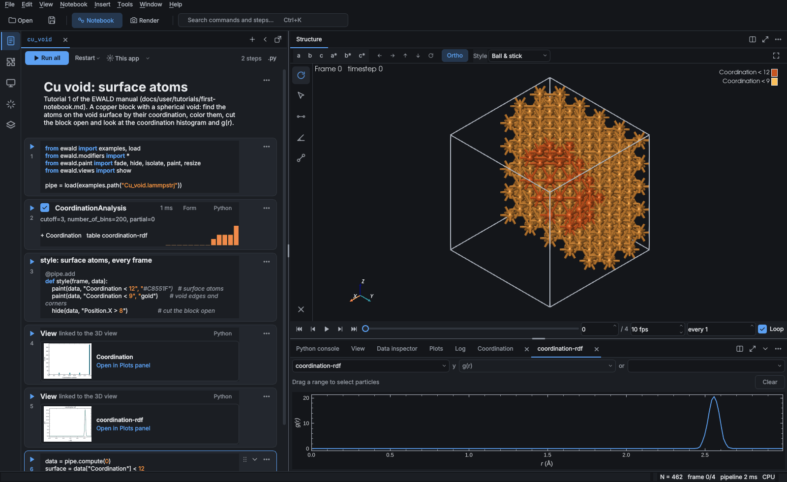

# Desktop GUI

```bash
pip install -e ".[gui]"
ewald gui XDATCAR                        # or: ewald-gui dump.lammpstrj --type-map 1=Cu
ewald gui run.lammpstrj --device cuda    # start with GPU compute
```

From Python, `ewald.gui.show(pipe)` opens the viewer on a pipeline you built in a script. In
Jupyter, run `import ewald.gui` and then `%gui qt` (in that order, so IPython picks PySide6 even
when PyQt is installed); `show` then returns at once and the window stays live next to the
notebook. Linux system libraries and startup errors: [Install](install.md#linux-gui-system-libraries).

The window has the analysis on the left as a [notebook](notebooks.md): Python cells, steps and
linked plots, saved as an `.ewd`, `.ipynb` or `.py` file, with one tab per open notebook. The
[tutorials](tutorials/first-notebook.md) walk through it. The viewport and timeline take the rest of the width, the AI chat opens left of the notebook from the activity bar, and the panel
below the viewport holds the Python console, the View tab (display settings), the data inspector, plots and the log. Tabs in the
middle can be rearranged as in VS Code (see [Panel layout](#panel-layout)).



The notebook is the pipeline: each step cell is one `pipe.add(...)`, so there is no separate
pipeline list. (Earlier versions had an OVITO-style "classic" layout with a pipeline panel; it
was removed, and a saved *Window layout* setting is ignored.)

Buttons use one line-icon set. By default mode switches and less frequent buttons (Open,
Notebook, Render) show an icon with text, and the tool rail and frequent buttons (Save, Fit)
show the icon alone, with the name and shortcut in the tooltip. Preferences ›
General › Toolbar buttons switches to icons only or to text only (which also drops the icons
from menus).

## Panel layout

The viewport and the panel below it are tab groups. Drag a tab onto another group to move it:
the middle of the group adds it as a tab, an edge splits the group in that direction, and a
tab bar inserts it at that place. Esc cancels the drag. To look at the pair correlation
function large, for example, drag the Plots tab onto the Structure tab: the plot fills the main area
and the Structure view waits behind its tab, without redrawing, until you click it again. Drop it on
the right edge of the Structure view instead to see structure and plot side by side; both follow the
timeline and linked selections.

Right click a tab (or use the group's menu button) for the same moves without dragging: Split
right, Split down, Move to editor area or panel, Maximize group, New plot view (a second plot,
for example g(r) next to the MSD) and Close or Return to panel. Double-click a tab to maximize
its group. View › Layout lists the moves with their shortcuts, and the command palette (Ctrl+K)
finds them too:

| Action | Shortcut |
| --- | --- |
| Split the current view to the right | Ctrl+Alt+\ |
| Move the current view to the next group (or split that way) | Ctrl+Alt+arrow |
| Maximize or restore the group (an editor group also hides the panel below) | Ctrl+Alt+M |
| Return the view to its home area, or close an extra plot view | Ctrl+Alt+W |
| Fold or unfold the panel | Ctrl+Alt+J |
| Back to the default layout | View › Layout › Reset layout |

The layout is saved with the window when Preferences › General › *Restore window layout* is
on (the default), extra plot views included. The Structure view itself never moves between windows:
it can be placed anywhere in the middle but not closed, and the timeline stays under the
editor area.

## Notebook workspace

**Viewport.** Drag to orbit and scroll to zoom (VTK's standard mouse controls). View › View
along a, b, c, a*, b*, c* aligns the view with a cell vector or reciprocal vector, as in
VESTA, and View › Zoom to fit (Ctrl+0) frames the cell. View › Theme applies a theme (Default,
VESTA, CPK, Journal, ASE, Dark slide, or a [theme plugin](../plugins/styles.md#themes)): element
colors, background, cell color and radius preset in one step; its Dark background and White
background entries change only the background.

**Styles.** The Style box on the view toolbar switches between Ball & stick (the default: small
balls and bonds found automatically), Space-filling, Simple (ASE) and Points; Preferences ›
Viewports › *Default style* picks the one a new window starts with. Simple (ASE) looks like ASE's
GUI: flat discs in the element color with a dark outline, bonds (on, like Ball & stick) as unshaded
sticks with outlined edges, and the ASE theme (white background). It is drawn with impostors, so it stays fast for any number of
atoms; leaving it restores the colors and background you had. Particles › Rendering = flat gives
the same look with any radius. Automatic bonds come from a VESTA-style table (Bonds), one row per
pair of types up to 1.15 × the sum of covalent radii; in compounds metal-metal pairs are left
out, so SrTiO3 gets Ti-O and Sr-O bonds but not Sr-Ti. Opening a structure with more than
Preferences › Elements › *Automatic bonds up to* atoms (100 000) turns bonds off, because the
bond search and the sticks would slow the viewport down; turn them on under Bonds if you want them. The tool rail on the left switches
between orbit, pick (click an atom to see its id, type, position and every property;
Shift+click adds atoms to the pick or removes them),
distance (click two atoms) and angle (click three atoms, vertex in the middle); right-click ›
*Keep measurement in the view* keeps a finished one in the notebook's view cell (`measurements`),
so it stays drawn and appears in pictures (*Clear measurements* drops them). Double-click
empty space or press Esc to clear the picks, measurements and selection (with any tool,
orbit included). Resting the
cursor on an atom with any tool shows its element, index (and id), Cartesian position in Å and,
when there is a cell, fractional coordinates, in a tooltip and on the right of the status bar.
The ray cast runs once, after the cursor rests (Viewports › Hover › *Hover delay*, 0.25 s), and
never while the view moves, so it costs nothing during rotation; *Atom info on hover* turns it
off. Atoms drawn only as periodic images (VESTA boundary) are not reported. The viewport
draws atoms as GPU impostors: each sphere is one point shaded per pixel, with the depth of the
sphere surface, so spheres stay round at any zoom, overlapping spheres and bonds intersect as
with meshes, and 100 000 atoms rotate smoothly. Viewports › Performance › *Sphere drawing* =
Mesh brings back triangle spheres (*Sphere resolution*, up to the *Impostor threshold*), and
*Smooth edges* (on) applies FXAA to outlines.
A right click (without dragging, which zooms) opens the viewport menu, whose entries follow
what is loaded and picked. With nothing loaded it offers Load file, Load remote file and the
examples. With picked atoms it starts with their count and Center view on picked, Select picked
atoms (an `ExpressionSelection` on their identifiers, so the same atoms stay selected on every
frame), Delete picked atoms (the selection plus `DeleteSelected`) and Clear picks. Phonon modes
add Phonon band structure, an NEB band adds NEB energy profile (both open the Plots tab), and a
volumetric grid adds Add isosurface (or Edit isosurface once there is one). A trajectory adds
Play/Pause and Overlay other frames, which draws every other frame as see-through copies behind
the current one (`OverlayFrames`; on by default for NEB folders), with its transparency (50 to
95 %) and whether only the atoms that move get copies. Show (bonds, simulation cell), View
along, Orthographic, Zoom to fit and Ask AI are always there.

**Plugin side bars.** A plugin can bring its own side bar (a sim-agent panel, a database
browser, ...): installing it adds a button at the bottom of the activity bar and an entry
under Window › Plugin panels (or a tab under the 3D view instead), it may add entries to the
menus and to the 3D view's right-click menu, and a plugin with settings adds its own page to
Preferences. Plugin side bars and tabs that were open come back at the next start where they
were. Switching the plugin off in the Plugins side bar removes all of it; its settings are kept
for when it comes back ([Side bar plugins](../plugins/gui.md)).

**Workflow side bars.** The built-in **Workflows** side bar reads folders of calculations
(relax, NEB, MD restarts, phonopy; File › Open workflow folder… or dropping a folder does the
same, see [Workflows](workflows.md)). Plugins that read finished calculations (sim-agent, AiiDA)
share its layout: the account, a search box that also takes an id, and the workflows newest
first. Expanding a workflow lists its steps (restarts of one calculation joined, sub-workflows
nested) with their files and structures. A double click on a step or output opens it; on a
workflow it opens the whole workflow as one notebook whose load cell names every step, a line
each (`relax = load(...)`, `scf = load(...)`), and sets `pipe` to the main result. To look at another step
in the 3D view, run `pipe = scf`; `show(scf, ...)` puts it in a view cell next to the others
([Workflow sources](../plugins/workflows.md)).

**AI chat (Ask AI).** The AI button at the bottom of the activity bar on the far left (also
Window › AI chat, Ctrl+J, and Ask AI in the Structure view's right-click menu) opens a chat side bar left of the
notebook. It reads like a
chat app: your messages in bubbles on the right, the answers under the assistant's name (Claude, Gemini, ...) on the left,
the tools it ran as small chips (*Running …*, then *Used …*), and code blocks as framed code with
*Copy* and *+ Insert as cell*. Enter sends, Shift+Enter starts a new line, and the suggestions
on an empty chat send a first question. While an answer is on its way the send button turns
into Stop (also Esc): the chat is free again at once and the stopped question is forgotten.
Each question also sends the current notebook's code and the errors of cells that failed when
they last ran (each only when it changed since the last question). Python blocks of an
answer go into the notebook at once as new code cells after the current one, without running
them (Shift+Enter runs a cell, Ctrl+Z takes one out again), and their button then reads
*✓ Inserted*. With Preferences › AI › **Code in answers** set to `button`, nothing is inserted
until you press *+ Insert as cell*. The AI can also read and edit cells itself
([Notebook cells](claude.md#notebook-cells)).
The chat answers questions about the picked atoms, such as "What are these atoms?" or "Why is the
coordination low here?". Without picks it uses the particles a selection modifier selected, and
with neither the question is about the whole frame. The model receives the description from
[Asking about a selection](claude.md#asking-about-a-selection) and a close-up render, can run the
usual tools, and steps it adds appear in the notebook. Claude answers by default; Preferences › AI
switches to OpenAI, Gemini or a model on your own machine ([Providers](claude.md#providers)). It needs
the `llm` extra and, except for a local server, an API key (Preferences › AI, or the provider's
environment variable such as `ANTHROPIC_API_KEY`).

**Timeline.** Play, step and scrub through frames. Every frame is computed through the whole
pipeline when you move to it. While a simulation is still writing the file, new frames are
added to the timeline as they appear ([live reload](formats.md#runs-that-are-still-writing)). A file of a
calculation that has not finished (VASP still running or killed) opens with what is complete,
and the status bar says what is missing ([details](formats.md#calculations-that-have-not-finished)).

**Steps.** Insert › Step (or the notebook's **+ Step** button and the command palette) adds a
modifier as a step cell. The cell's checkbox disables it without removing it, Move cell up/down
reorders it, and its header shows the time it took and, if it failed, its error. A failing step
is skipped so the view never goes blank. The step's parameter form is generated from the
modifier's constructor, so every argument you can pass in Python can be edited there. See
[Notebooks](notebooks.md).

**View tab (display settings).** The View tab, next to the Python console below the Structure view
(Window › View settings), shows how the structure is drawn as cards in equal-width columns:
**Atoms** (style preset, radius table, radius scale, oxidation states, how atoms are drawn, *Draw
atoms* off for a stick model), **Types** (color, radius, transparency and count per type, VESTA
elements.ini import), **Bonds** (sticks, the pair table, *As step* for a Create bonds step),
**Surfaces** (polyhedra, isosurfaces and slices that steps made, by name: shown, color,
transparency, edges; *Reset* gives back the step's look), **Cell** (line width, *Replicate cell* and
VESTA's *Boundary* range), **Labels** (text on each atom such as `{type}{index}`, *Highlight
selection*), **Camera** (what the view cell says about the camera and frame, the key *Light*, *Save
camera*) and **Elements** ([visual element plugins](../plugins/visuals.md), added with *Add
element*). Every form shares one label column, so fields line up across cards; sub-sections such as
Replicate cell, Boundary and Light show their rows only while ticked. Click a card's title to fold
it (it stays folded while the window is open). Every value is a setting of
the notebook's `view(pipe, ...)` cell: the rows the cell sets are highlighted, the card says *in
notebook*, and the tooltip shows the value. A change made here is written back into that cell, and
a change made in code (the cell, the console, Ask AI) shows up here. When the tab is narrow (dragged
beside the 3D view), the cards stack in one column.

The boundary range: tick Boundary and set the fractional range (e.g. -0.1 to 1.1) to draw the
periodic images of atoms on the faces, edges and corners, with bonds and polyhedra completed across
the cell; [display only](rendering.md#boundary-vesta). Replicate cell draws a na x nb x nc block of
cells (OVITO's Replicate as a display setting; also under View › Replicate cell and the 3D view's
right-click menu); the data and analysis keep the original cell, see
[Replicated cell](rendering.md#replicated-cell). A plugin element has a checkbox to hide it, a
parameter form generated from its constructor (Apply or Ctrl+Enter redraws) and a remove button.
Plugin elements are saved with the session and drawn in rendered images too. *Save camera* writes
the current camera and frame into the view cell. The Camera card's Light box sets the key light
(azimuth and elevation from the viewer, intensity) for the viewport and every renderer; unchecked,
the default light is used.

**Python steps.** A code cell can define a function and add it with `pipe.add(fn)`; it runs on
every frame like any other modifier. Insert › Step › Python › Python script adds the
`PythonScript` modifier as a step. See [Python scripting](scripting.md).

**Python console.** An IPython console where `pipeline` (also `pipe`), `data` (the current
frame), `viewer` (the window), `vp` (the viewport), `mods` (`ewald.modifiers`) and `np` are
defined. Changes made in the console, such as `pipe.modifiers.append(...)`, update the
notebook and redraw the view.

**Data inspector.** The particle table with a filter expression (the same syntax as
`ExpressionSelection`), plus global attributes, tables, the cell and the data source (file,
reader, number of frames, particle properties).

**Plots.** Any table in the current frame (g(r), MSD, histograms, time series) can be plotted
and saved. The `Thermo` table (log.lammps, OSZICAR, OUTCAR, vasprun.xml; see
[File formats](formats.md#simulation-results)) is drawn one column at a time, picked under
"y", with a dashed line at the current frame's step that follows the timeline. The `NEB`
table (a NEB folder, or `NebEnergyProfile`) is drawn as the energy profile: the spline, the
images as points, the current image highlighted and the barriers in the corner. Clicking an
image jumps to its frame. Diffraction
reflections (`diffraction-peaks`) are drawn as sticks, and a measured pattern loaded through a
modifier's `experimental` file (the "…" button picks it) as points under the calculated curve.
The `DOS` and `Bands` tables of a VASP run are drawn as a density of states and a band
structure; atoms selected in the viewport show as their projected DOS or as fat bands (see
[DOS and band structure](electronic.md)).

**Zoom, pan and hover.** Every plot (the Plots tab and view cells) moves the same way. The
wheel zooms the x axis around the cursor and Ctrl+wheel the y axis (on a band structure the
wheel zooms the energy). A right or middle drag pans, and a double-click goes back to the full
range. On a plot that selects nothing (DOS, bands, phonon bands, maps) a left drag zooms to the
dragged range; elsewhere a left drag still selects. The zoomed range stays while the frame
changes, and *Save plot…* writes the range you see. The DOS and the band structure share one
energy window, shown in the **E** boxes, where you can also type it. Hovering shows the values
under the cursor (*E* − *E*<sub>F</sub> on electronic plots), and on a per-frame or NEB plot
also the frame or image a click goes to, with its value.

*Save plot…* (and *Save plot…* in a view cell's menu) writes a publication figure, not a
screenshot of the panel: the plot is redrawn at a journal column width (Preferences ›
Rendering › Plots: 1-column 3.5 in, 1.5-column or 2-column 7.2 in) with 8 pt sans-serif type,
inward ticks on all four sides, labels with units (*r* (Å), 2*θ* (°), *q* (Å⁻¹), MSD (Ų),
*E* − *E*<sub>F</sub> (eV)), a colorblind-safe color cycle and a white background,
whatever the UI theme. PDF, SVG and EPS keep the text as text (TrueType, editable in
Illustrator or Inkscape); PNG uses the DPI of the image quality (Draft 150, Standard 300,
Publication 600). Hints such as the current-frame marker are left out. On screen the same
style is drawn in the Paper or Graphite colors.

**Linked selection.** Plots and the viewport share one selection, in both directions:

- Drag an x range on a histogram (the "histogram of" box, `Histogram`, CSP or PTM RMSD), g(r),
  bond length or bond angle plot to select the particles behind it: particles with that
  property value, particles in a pair at that distance (only A-B pairs on a partial `g(r) A-B`
  column), both ends of the bonds with that length, or the vertex atoms of those bond angles.
  They are picked in the viewport, so Ask AI about selection uses them, and the range is
  re-applied on every frame. **Keep as selection** turns a property range into an
  `ExpressionSelection` modifier.
- Drag on a per-frame plot (`Thermo`, `time-series`, `plumed`, `colvar`, MSD) to select the
  frames in that x range; Shift+drag a box to select by value as well (for example the frames
  where a CV lies in a window). Drag a box on a 2D free energy surface to select the frames whose
  CV pair (from `LoadColvar` or `Plumed`) falls in it. The frames are marked on the timeline,
  playback steps through them only, and the ✕ on the timeline clears them. A click on a
  per-frame plot (or an NEB profile) jumps to the nearest frame, and a click on a free energy
  surface jumps to the frame whose CV pair is nearest to it.
- The other way, atoms picked in the viewport (or the `Selection` property) are drawn on the
  plot: as a highlighted sub-histogram on count plots, or as a second axis ("selected") on g(r).
  Selected frames are marked as points on per-frame plots.

The same mapping is available without the GUI in `ewald.linking` (`link_for`,
`atoms_in_range`, `frames_in_box`, `selection_expression`).

**Command palette.** Window › Command palette searches every menu action and every modifier by
name.

## Render workspace

Window › Render workspace (Ctrl+2), or the Render button, opens the figure settings: renderer
(the built-in ray tracer or OpenGL), anti-aliasing samples, ambient occlusion and shadows,
journal size presets (1-column 3.5 in, 2-column 7.2 in, square, 16:9 slide) at a chosen dpi,
background (white, transparent, black, or the viewport's), overlays, and an output file.
Under Overlays, "+ Overlay" adds an overlay element (Coordinate tripod, Attributes, or an
[overlay plugin](../plugins/overlays.md)) with a checkbox and a parameter form.
The ray tracer renders in the background: the window stays usable, a spinner beside the picture
size reads "Ray tracing… 40%" until the picture appears under *Last render*, and *Render* turns
into *Cancel*, which stops the trace after the rows being traced (no file is written). In Python,
`render(..., renderer="raytrace", progress=fn)` calls `fn(done_rows, total_rows)` the same way;
returning `False` stops it with `RenderCancelled`. OpenGL and vector output are quick and render right away.

The left side is the live 3D view with the picture's frame on it: the part outside the frame
is dimmed, and the frame keeps the output's aspect ratio and its place on screen, so zooming or
turning the view changes what is inside it and the picture is exactly what the frame covers.
Drag a corner to resize the frame, a side's middle handle to change the picture's aspect (the
pixel size becomes Custom), or the frame's edge to move it; inside the frame the mouse turns and
zooms the view as usual. *Fit to structure* zooms and centers the view so the structure fills
the frame, *Reset frame* goes back to the largest centered frame. After Render, *Last render*
shows the picture; *3D view* goes back. The frame is the `region` of the notebook's view
(`view(pipe, region=[x, y, height])`, see [Rendering](rendering.md#options)), so it round-trips
with the notebook, and View › Write view to notebook stores it with the camera. Preferences ›
Viewports › Render frame in the 3D view, or right-click › Show › Render frame, shows the frame
outside the Render page too. The frame is not drawn yet on the OpenGL 1.x viewport used over
`ssh -X`. The "Python for this figure" panel shows the script that
produces the same image with `pipe.render(...)`, updated as you change settings, so a figure
made in the GUI can be reproduced in a batch script. See [Rendering figures](rendering.md).

## Files

File › Open example opens one of the [example files](quickstart.md#example-files) shipped
with ewald. File › Open opens any format ewald can read ([File formats](formats.md)), including
formats added by [reader plugins](../plugins/readers.md). LAMMPS dumps ask for a
type-to-element map unless you set a default in Preferences. File › Load NEB folder opens a
VASP NEB folder (`00 .. NN`) or a LAMMPS NEB run folder with one frame per image
([NEB runs](formats.md#neb-runs)); opening a single image file of such a run asks whether to
open the whole band. Files, notebooks and NEB folders can also be dropped on the window. In the notebook layout, File › Open also opens `.py`
notebooks, and File › Save notebook writes one ([Notebooks](notebooks.md)). File › Export data writes the
current frame or the whole trajectory through `export_file`, and File › Export movie writes an
MP4 or GIF (needs the `movie` extra). File › Live reload turns following a growing trajectory
on or off for the session; the default and the interval are in Preferences › General.

File › Load remote file (SSH) browses a folder on another machine once. For machines you use
often, the Remotes side bar (the monitor icon in the activity bar, or File › Remote computers,
Ctrl+Alt+R) keeps saved remote computers with their login, jump host, start folder and
bookmarks, and browses their files; passwords and key passphrases go to the OS keychain
([Saved remote computers](formats.md#saved-remote-computers)).

File › Open location (Ctrl+L) takes a typed path or address, the same text `load()` takes in a
notebook cell: `host:/path` over SSH, or a scheme a reader plugin serves, such as `aiida:1234`
or `simagent:1234`; the dialog lists the schemes that are installed. A plugin that needs setting
up (a server address, an access key) has its own page in Preferences, a Settings button in the
Plugins side bar and an entry under Edit › Plugin settings, so it can be set up without Python.

## Preferences

Edit › Preferences (Ctrl+, ; the application menu on macOS) has seven pages: General, Viewports,
Elements (per-element color and radius, Jmol or CPK scheme, radius preset, VESTA `elements.ini` import),
Rendering, Compute (device, CPU threads, installed components), Python (console
startup script, extra module paths) and AI (provider, API key, model, server URL and effort for Ask AI; see
[API key](claude.md#api-key)), followed by a page for each installed plugin that has settings
(its fields, its buttons such as Test connection; Apply and OK save them through the plugin). Only values that differ from the defaults are saved, as
JSON in the ewald config folder: `~/.config/ewald` on Linux,
`~/Library/Application Support/ewald` on macOS, `%APPDATA%\ewald` on Windows, or
`$EWALD_CONFIG_DIR` when set. Preferences affect the GUI only; scripts that call `compute` or
`render` are not changed by them.

The radius preset (covalent, atomic, van der Waals or Shannon ionic radii; see
[Atom radii](rendering.md#atom-radii)) is the one new sessions start with. The Atoms card of the
View tab switches it for the current session and takes oxidation states
for the ionic presets (`Sr=2, Ti=4, O=-2`; types left out are guessed). The log says which
types fell back to covalent radii.

### Large systems

Interaction comes first in the viewport, and quality comes first in rendered output. Under
Viewports › Performance, *Detail while moving* (Auto by default) controls what happens while
you rotate, zoom, drag the timeline slider or play. Auto switches to a coarse scene only when a
full-detail frame takes longer than 1/*Target frame rate* (30 fps). The coarse scene uses
impostors, leaves out bonds and draws every k-th atom, so at most *Atoms while moving*
(1,000,000) remain. Full detail returns after *Refine after* (0.3 s) of idle. *Always coarse*
and *Always full* fix the choice. When frames are requested faster than they can be computed,
the queued requests collapse into the latest one. The pipeline runs on a worker thread, so the
window stays responsive while a long analysis computes: the view keeps the previous result and
the status bar says *Computing frame n…* until the new one arrives, and changing the frame or a
parameter meanwhile cancels the running computation (trajectory modifiers stop at their next
frame). Results that take less than 50 ms appear at once, as before. Compute › Device ›
*Compute in the background* turns this off. Rendered images and movies always use full
detail. Compute › Memory › *Frame cache memory* (2048 MB) caps how much the trajectory frame
cache holds; the current frame is always kept. Scripts set the same cap with
`Pipeline(..., cache_memory=bytes)` or `pipe.cache_memory`.
`python benchmarks/large_files.py` times opening, frame switching and memory on generated
multi-million-atom files. `python benchmarks/analysis.py` times the analysis modifiers on a
108k-atom crystal and the ray tracer at each quality preset.

The viewport draws a change once, in the next repaint: several changes made before the
repaint (a new frame, picks, a camera move) cost one render, a mouse move while rotating costs
one render rather than two, and nothing is redrawn while the window is idle or the viewport is
hidden, which includes the Structure view sitting behind another tab (it draws the last frame when you
return to it). The Data inspector and plot views follow the current frame only while they are
on screen; a plot range linked to the viewport keeps following it either way.

*Viewport renderer* picks the viewport itself. Auto uses VTK, except on an SSH-forwarded display
(`ssh -X`), where it uses Legacy GL: OpenGL 1.x display lists drawn like VESTA, with the frame text
above the view instead of on it, mesh spheres (points above 400,000 atoms) and no smooth edges or
color bar. See [Troubleshooting the GUI](install.md#troubleshooting-the-gui). It takes effect at
the next start; `EWALD_VIEWPORT=vtk|legacy-gl` overrides it.

*Device* is where analysis runs, for the window and for the notebook's `pipe` alike. It is the
CPU by default, the safe choice; CUDA uses the NVIDIA GPU through CuPy, and Auto uses the GPU
when CuPy finds one (the status bar then reads `AUTO (CUDA)`) and the CPU otherwise. A change
applies at once.

## Help

The Help menu opens this manual, the plugin guide and the API reference. By default it opens
the `docs/` folder of the repository on GitHub; set Preferences › General › Documentation URL
to point it at a hosted copy of the site instead.
