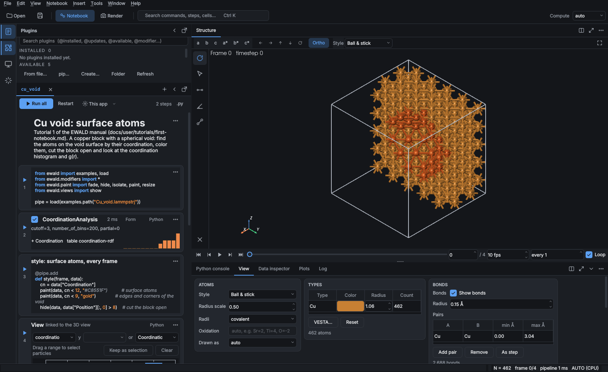
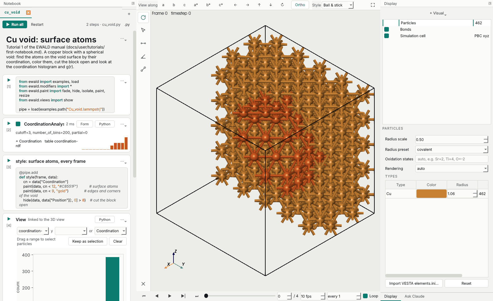

# Notebooks

In the desktop GUI, your analysis is a notebook: Python cells that build the pipeline, plots of
its results, and notes. It works like Jupyter. It is saved as an `.ewd` file (code, results,
figures and data in one file, see [Notebook files](#notebook-files)), as a Jupyter `.ipynb`, or
as a plain `.py` script that `python analysis.py` runs without the GUI and VS Code, JupyterLab
with jupytext and Spyder open as a notebook.

```python
# %% [markdown]
# # Cu void annealing

# %%
from ewald import load
from ewald.modifiers import *
from ewald.views import show, view
from ewald.paint import paint, hide
pipe = load("cu_void.lammpstrj")

# %%
pipe.add(CoordinationAnalysis(cutoff=3.08))

# %%
pipe.add(ExpressionSelection(expression="Coordination < 12"))

# %%
show(pipe, table="coordination-rdf")
```

`# %%` starts a cell and `# %% [markdown]` a text cell (the percent format). Text after `# %%`
is the cell's title.

## Cells

All cells run in one Python namespace. The variable `pipe` is the notebook's pipeline, and the
viewport shows it. Run a cell with ▶ or Ctrl+Enter, or with Shift+Enter to run it and move to
the next one. Notebook › Run all (Ctrl+Shift+Enter) restarts the namespace and runs every cell
from the top. If a cell fails, its traceback appears under it, and Run all stops there and
marks the cells below as stale.

The number beside a cell's run button is its run count, as in Jupyter. It shows `*` while the cell runs,
`·` when an earlier cell changed and the cell is out of date (its card turns flat), and the cell gets a red
border with the traceback in a red-barred box when it fails.

The chevron under a cell's counter (shown when you hover over a cell or select it) folds the cell to one line (its title, step name or first line of
code); clicking it again or a double-click unfolds it. Folded cells stay folded in `.ipynb` and `.ewd` files,
as JupyterLab's hidden input and output, so they open folded in Jupyter too.

Running a cell again replaces the modifiers it added last time, in the same place, so you can
edit a cell and re-run it without stacking duplicates. A cell that assigns `pipe` again (a new
`load`) re-runs the cells below it on the new pipeline.

There are six kinds of cell.

**Step cells** are a single `pipe.add(Modifier(...))`, optionally preceded by imports
(`pipe.modifiers.append(...)` works too; `load` is another name for `import_file`). The notebook shows them as a step: the modifier's name, its parameters, a checkbox to
switch it off, the time it took and what it produced (new properties, selected atoms, tables,
removed atoms). A small histogram or curve of the new property or table sits next to the
results. *Form* opens the parameter form, and Apply writes the new values back into the cell's
code. *Python* shows the code. Insert › Step (or **+ Step** under the cells) adds a step with
default parameters after the current cell. Steps that cannot work on the current frame are
greyed out, and their tooltip says what is missing (a volumetric grid, a vector property, a
trajectory, a selection, PTM orientations). Bond analyses (bond angles, bond lengths, rings)
add `CreateBonds(mode="covalent")` first when the data has no bonds, and Coordination polyhedra
center on the smallest cation of a compound (Ti in SrTiO3) unless atoms are selected.

**View cells** are a single `show(pipe, ...)` call. Each is a live plot of a data table or a
particle-property histogram:

```python
show(pipe, table="coordination-rdf")         # g(r), XRD, S(q), DOS, Bands, Thermo, NEB, ...
show(pipe, table="DOS", y="Ga d")            # one column
show(pipe, histogram="Coordination")         # histogram of a particle property
show(pipe, table="DOS", xlim=(-3, 2))        # the range shown (DOS energy window)
```

In the GUI the plot is linked to the Structure view, like the Plots tab. Dragging an x range selects
those atoms, or those frames on a per-frame plot. The atoms you pick appear on the plot. The DOS
and the band structure follow the picked atoms as projected DOS or fat bands, and clicking a
phonon band plays that mode. Choosing another table, column or histogram in the plot's bar
rewrites the cell, and so does zooming: the wheel, a drag on a DOS or band plot, or a pan
writes `xlim=`/`ylim=`, and a double-click removes them. Run as a script, `show` draws the same plot with matplotlib. Add one with
**+ View** or Insert › View, which list the tables and properties of the current frame.

Every plot ewald draws (view cells, `show`, a verb table's picture, the figures saved into an
`.ewd`) uses one publication style from `ewald.plotstyle`: a 3.5 in single-column figure,
8 pt sans-serif text, inward ticks with minor ticks, axis labels with units and a
colorblind-safe color cycle. Use it for your own figures too:

```python
from ewald import plotstyle
from ewald.views import figure

fig = figure(pipe, table="coordination-rdf", size="2-column")   # a Figure, no pyplot
plotstyle.save(fig, "gr.pdf")                # editable text, tight box; PNG at 600 dpi
with plotstyle.context():                    # the style for your own matplotlib code
    plt.plot(r, g); plt.xlabel(plotstyle.axis_label("r"))
```

Plots your cells draw themselves with plain matplotlib (`plt.plot(x, np.sin(x))`, in notebook
cells, in a notebook's kernel and in the Python console) get the same style by default, with no
import. Each notebook keeps its own rcParams: whatever a cell sets (`plt.rcParams[...] = ...`,
`plt.style.use(...)`) stays for the next cells of that notebook and is never overridden, and
ewald's own renderers are not affected. `plotstyle.use("default")` in a cell goes back to
matplotlib's defaults for that notebook, and `plotstyle.use()` to the publication style.
Preferences › Python › *Style of your own plots* chooses the default: *Publication* (print
colors, so `plt.savefig` writes what you see), *Publication in UI theme colors*, or
*Matplotlib default*. Restarting the notebook resets its rcParams.

Spectra, diffraction patterns and time series are not separate panels. They are views in the
notebook, next to the steps that compute them.

**Code cells** are any other Python. Printed output appears under them, as does the value of the
last line (as in Jupyter). Matplotlib figures are shown as images, without `plt.show()`
opening a window, and so are a pipeline (`pipe` as the last line draws frame 0) and a verb
table (its curve); a frame (`pipe.compute(0)`) shows its summary.

**Styling cells** color, resize or hide atoms by any property. A Python step runs on every
frame, so the style follows the trajectory:

```python
@pipe.add
def style(frame, data):
    cn = data["Coordination"]
    paint(data, cn < 12, "crimson")             # any matplotlib color or RGB
    hide(data, data["Position"][:, 0] > 9)      # cut the block open
    resize(data, "Coordination < 9", 1.3)       # a condition can be an expression string
```

`paint`, `hide`, `isolate` (hide the rest), `fade` and `resize` write new Color, Transparency
and Radius properties, which every renderer draws. Import them with
`from ewald.paint import paint, hide, isolate, fade, resize` (new notebooks already do).

**The view cell** holds the Structure view's display settings: one `view(pipe, ...)` call.

```python
view(pipe, style="Ball & stick", theme="VESTA", colors={"O": "red"}, radii={"Ti": 0.6},
     bonds=True, cell=False, background="white", direction="z", zoom=1.3)
```

Everything you can change in the viewport is a setting here: the style preset, theme, element
colors and radii, radius preset and oxidation states, bonds on or off and the bond table, the
cell, the background, the VESTA boundary, plugin visual elements and vector arrows, the camera
(direction, zoom, projection or an exact camera) and the frame, and the picture settings
(renderer, quality, size, text, legends, scale bar). See [Rendering › The view of a
pipeline](rendering.md#the-view-of-a-pipeline) for the list. Running the cell redraws the
viewport. Changing the style in the viewport, the View tab or the View menu writes the
change back into this cell (a new one appears at the end when there is none), so the notebook
always says how the picture was made. Insert › View settings with the camera also writes the
current camera and frame. `pipe.view` is the same thing one setting at a time
(`pipe.view.bonds = False`, `pipe.view.color("O", "red")`, `pipe.view.look("x").rotate(30, 15)`),
or one visual element at a time (`pipe.view.elements["Bonds"].radius = 0.12`,
`pipe.view.surface("coordination-polyhedra", color="teal")`), and Claude's `set_view` tool changes it too.

**Analysis cells** use a verb: one call adds the analysis step and returns its table.

```python
from ewald import rdf, msd, sq, xrd, vacf, bond_angles, cna, ptm, voronoi, clusters
g = rdf(pipe, cutoff=6)          # CoordinationAnalysis; g.x is r, g["g(r)"] the curve
d = msd(pipe, time_per_frame=2)  # MeanSquaredDisplacement over the trajectory
g                                # shows the g(r) curve; repr(g) is <Table 'coordination-rdf': ...>
cna(pipe).counts                 # {'OTHER': 3, 'FCC': 497, 'HCP': 0, 'BCC': 0, 'ICO': 0}
voronoi(pipe)                    # bars: particles per Voronoi coordination number, per type
clusters(pipe, cutoff=3.2)       # cluster sizes, largest first; .counts is {id: size}
```

Counting tables (`cna`, `ptm`, `voronoi`, `clusters`) show as bar charts and have `.counts`.
Insert › Analysis adds any of these as a cell and runs it, with defaults that fit the current
frame (a g(r) cutoff below half a small cell, bonds created before bond angles); MSD and VACF
are greyed out for a single frame.

A table is a dict of numpy columns with `.x`, `.columns` and `.plot()`; `pandas.DataFrame(g)`
turns it into a data frame.
Running the cell (or calling the verb) again replaces the step it added, so changing
`cutoff=` never stacks duplicates. `show(pipe, table="coordination-rdf")` puts the same table
in a live view cell.

**Text cells** are Markdown. Double-click one to edit it.

**Snapshot cells** keep a picture of the Structure view. Insert › 3D snapshot of the view adds one for
the viewport as it is (frame, camera, display style) and runs it:

```python
from ewald.views import snapshot
snapshot(pipe, frame=3, camera={...}, radius_scale=0.5)   # shows the picture; .save("fig.png") writes it
```

The ⋯ menu of a cell has Run, Run this and below, Clear output, Move up/down, Delete and, for steps and views,
Show as code cell. Notebook › Clear cell output (Ctrl+Shift+Backspace) and Clear all outputs
(Ctrl+Alt+Shift+Backspace) remove printed text, values, figures and run counts, as Jupyter's Clear outputs; the
pipeline and its results stay, and the next save leaves the outputs out of the `.ipynb` or `.ewd`. Drag a cell by the dotted grip above its run button (it appears on hover) to move it; steps move with it in the
pipeline. The `.py` button at the top shows the whole file.

## Notebook tabs

Each open notebook has a tab at the top of the notebook panel. **+** or
File › New notebook (Ctrl+T), or a double-click on the empty part of the tab row, opens an empty one.
Right-click a tab to rename or close it, or double-click it to rename. Drag a tab along the row to reorder
the notebooks; drag the empty part of the row to move the whole Notebook panel to another side of the window,
as with any panel's title bar.
A dot marks unsaved changes. Each notebook has its own namespace and pipeline, and switching to
a notebook that has a pipeline shows it in the viewport.

Opening a data file (File › Open, or `ewald gui file`) makes a notebook for it: the imports, a
`load` cell and one step per modifier the file needs. It replaces the empty notebook you
start with. File › Open on an `.ewd`, `.ipynb` or `.py` file opens it as a notebook. The cells
only run after you choose to (Notebook › Run all), because a notebook is code. Preferences ›
Python › *Run notebooks when opened* can change that to always run them or never run them.

File › Save notebook (Ctrl+S) writes the notebook file; the first time it asks for a name and a
format, `.ewd` unless you pick another. Sessions (`.ewald`) still load and save from the File
menu.

## Notebook files

| Format | Keeps | Opens in |
|---|---|---|
| `.ewd` | code, outputs, figures, small data files, plugins, view state | ewald (unzipped: Jupyter, any CSV/SVG tool) |
| `.ipynb` | code, outputs, view state | ewald, Jupyter, VS Code, GitHub |
| `.py` | code, view state, kernel, data links | ewald, `python`, VS Code, jupytext; the one to keep in git |

A `.py` notebook keeps what ewald needs besides the code in a jupytext-style comment header,
which Python, VS Code and jupytext ignore or keep:

```python
# ---
# jupyter:
#   ewald:
#     kernel: {"python": "/opt/conda/envs/ml/bin/python", "display_name": "Python (ml)"}
#     state: {"frame": 3, "camera": {...}, "style": {...}, "render": {...}}
#     data: [{"path": "traj.dump", "size": 81234567, "fingerprint": "sha256-ends:..."}]
# ---
```

Opening it restores the viewer and says when a linked data file changed or is missing, as for
an `.ewd`. Each notebook tab also keeps its own Render page settings (renderer, quality, size,
overlays): switching tabs switches them, and saving the notebook saves them.

An `.ewd` file is a zip archive:

```
analysis.ewd
├── notebook.ipynb   code and outputs (a standard Jupyter notebook)
├── manifest.json    ewald version, data files, plugins, style, camera and frame
├── figures/         each view cell as SVG and PNG, and the plotted data as CSV
├── data/            data files up to 50 MB
└── plugins/         plugin files from your plugin folder that the steps use
```

Larger trajectories stay links: the manifest keeps their path (relative to the `.ewd` file),
size and a fingerprint of their first and last MiB. When you open the notebook, ewald finds
each file next to the notebook or in the copy the `.ewd` carries, and says when a file moved,
changed or is missing. `load("traj.dump")` in a cell looks in the same places, so a notebook
you send with its data, or one that carries it, runs on another computer. Preferences › Python
sets the size limit (*Copy data files up to*, 0 for links only) and whether figures are saved.

An `.ewd` from someone else opens **restricted**. You see its code, outputs and figures, but no
cell runs and its plugins are not imported until you agree: opening asks (unless *Run notebooks
when opened* is *never*), and so do Run all and running a single cell. A bar over the cells
says the notebook is restricted, with *Trust* and *Trust and run all*; Notebook › *Trust
notebook…* does the same. Answering *Yes* when the file opens trusts it too and hides the bar. Trust lasts while
the notebook is open; opening the file again asks again. A plugin you already have installed under the
same id is used instead of the copy in the file. Plugins that came from a pip package are not
in the file, only their package and version: when you don't have one, a second bar names it with
the steps that need it, and *Install…* runs pip for them in the Plugins side bar after you
confirm the command (`Notebook.load(...).warnings` lists them in a script). A `.ipynb` written by Jupyter opens the same
way as a `.py`; `pipe.add(...)` cells become steps and its outputs are kept.

## Kernels

A notebook's cells run in the app's own Python unless you pick another one. There they run on a
worker thread: a cell that takes a while shows `*` and the window stays usable, and
**Interrupt** in the notebook's bar stops it at its next Python line (a long numba or C call
finishes first) with a `CellInterrupted` error under the cell; Run all stops there. `plt.show()`
in a cell puts the figure under the cell. From a script, `nb.interrupt()` stops a cell running
on another thread. The kernel button (gear icon) in the
notebook's bar (or Notebook › Kernel) lists *This app's Python*, the Jupyter kernels installed
on the computer and *Other Python…*, which takes any interpreter, for example a conda
environment's `envs/ml/bin/python`. The cells then run in a kernel started from that Python, so
a notebook can use packages ewald's GUI cannot import there. That Python needs ewald and
ipykernel (`pip install ewald ipykernel`), not the GUI extras. The choice is saved with the
notebook (`.ipynb` and `.ewd`), and the kernel starts when a cell first runs; Restart and Run all
restart it, and closing the tab or the window stops it.

The rules are the same as in the app: re-running a cell replaces the steps it added, and a new
`pipe` re-runs the cells below. `pipe` in the app is a pipeline over the kernel's one: the
kernel computes each frame and sends back its particles, cell, bonds, tables, attributes,
surfaces (polyhedra, isosurfaces), voxel grids, vector styles and the electronic structure
(and phonon modes) behind DOS and band plots, so the viewport, view cells, plots and Display
settings look and work as in the app. Plots the cells draw themselves get the notebook's plot
style there too. Step cells keep their form and on/off checkbox: the
app builds a local copy of each step from its cell, an edit runs the cell again in the kernel,
and the status, time and results of the kernel's steps come back with every frame (a failing
step is skipped and reports its error on its cell, as in the app). The window stays usable
while a cell runs; **Interrupt** in the notebook's bar stops it with a `KeyboardInterrupt`
shown under the cell. From Python:

```python
from ewald.kernel import Kernel, available
nb.set_kernel(Kernel(python="/opt/conda/envs/ml/bin/python"))   # or Kernel(name="ml") from available()
nb.run_all()
nb.pipeline.compute(0)                                           # computed in the kernel
nb.set_kernel(None)                                              # back to this Python
```

## Undo and redo

Edit › Undo (Ctrl+Z) and Redo (Ctrl+Shift+Z) step through the notebook's edits, one entry per
action: inserting, deleting or moving a cell, running cells (with what you typed into them), a
step form (dragging one slider counts once) and pipeline changes made from elsewhere (console,
Ask AI, viewport tools). The menu names the entry it would undo. While the cursor is in a
cell, Ctrl+Z undoes typing in that cell instead.

Undo restores the cells' text. Step and view cells that come back or change run again, so the
pipeline and the viewport follow; other code cells are marked stale and run only when you run
them, since they may do anything (write files, read data). Each notebook tab has its own
history, which starts empty when the notebook is opened.

## Plugins and changes from elsewhere



The puzzle icon on the far left opens the **Plugins** side bar, next to the notebook (Window ›
Plugins, Ctrl+Shift+X). It lists the installed plugins, with where each comes from (plugin
folder, pip package or this session) and any error it raised, and the plugins you can install:
ewald's example plugins, the default plugin index and every catalog in Preferences › Python ›
*Plugin catalogs* (see
[Packaging and sharing](../plugins/packaging.md#plugin-catalogs)). Type to search, or filter with
`@installed`, `@updates`, `@available` or a kind such as `@modifier`. *Install* copies a plugin file into the
plugin folder and loads it at once; a `pip:` entry runs pip in the Python ewald runs in, after
you confirm the command. *Update to …* appears on an installed plugin when a catalog has a
newer version (the Plugins icon on the activity bar then carries the number of updates, and
`@updates` lists them), and entries that need a newer ewald are greyed out. *Disable* switches a plugin off without removing it
([Switching a plugin off](../plugins/packaging.md#switching-a-plugin-off)); disabled,
incompatible and failed plugins say so in their row. *Remove* moves a file to the plugin
folder's `.removed` folder (its steps stay available until ewald restarts). Selecting a modifier plugin shows its documentation
and *Add as a step in the notebook*. *Create…* asks the AI to write a new plugin.

Plugin modifiers ([Writing plugins](../plugins/index.md)) are steps like the built-in ones.
Insert › Plugin step (or **+ Plugin**) lists the installed ones and writes the import line for
you, for example `from ewald.modifiers import ShiftZ`. *Load plugin file…* adds a cell that
registers the modifiers of a `.py` file:

```python
from ewald.plugins import load_plugin_file
load_plugin_file("~/plugins/local_strain.py")
```

Modifiers added outside the cells become step cells in the right place. That covers the Python
console, Ask AI, a plot's *Keep as selection*, the bond tool and the phonon band plot. Steps
whose modifier was removed disappear. The console sees the notebook's variables, and `notebook`
is the notebook object itself.

## From Python

```python
from ewald.notebook import Notebook

nb = Notebook.load("analysis.py")
nb.run_all()                      # False if a cell failed; errors are in cell.outputs
data = nb.pipeline.compute(0)
nb.add_view(histogram="Coordination")
nb.save()
nb.save("analysis.ewd")           # or .ipynb; save_ewd options: figures=, data_limit_mb=, plugins=

sent = Notebook.load("from_a_colleague.ewd")
print(sent.warnings)              # data files that moved or changed
sent.trust()                      # load its plugins and allow it to run
sent.run_all()
```

`Notebook.from_pipeline(pipe)` makes a notebook from a pipeline built in a script.

## Layout

The notebook layout is the only one (the OVITO-style "classic" layout was removed). Display
settings (particle radii and colors, bonds, cell and visual plugins) are in the **Display** panel
on the right; the AI chat opens left of the notebook from the activity bar, and code from its
answers can be inserted as cells. View › Focus on the viewport (Ctrl+\\)
hides the panels, and pressing it again brings them back. The chevron at the right of a panel's title bar (for the
Notebook panel, at the right of its tab row; or a double-click on the title) folds that panel: the Notebook, Plugins, Display and AI chat
panels fold to a thin strip with their name written down it, and the Data panel to its title
bar. Panels shown as tabs fold together, and their tabs turn sideways; click the strip, its chevron or a
tab to unfold. The button next to the chevron floats a panel in its own window. Every panel
header (Notebook, Structure, Display, the side bars) has the same height and buttons, so their
titles line up. View › *Minimal mode* (Ctrl+Shift+M) hides the menu bar, toolbars and status
bar, leaving the notebook and the viewport. Every command stays one search away in the command
palette (Ctrl+K) and menu shortcuts keep working. To get the menus back, press Ctrl+Shift+M
again or click **Menus** in the bottom left corner; a tap on Alt shows the menu bar for one
pick without leaving minimal mode. *UI theme* picks Paper (light, the
default), Graphite (dark) or a theme from a plugin ([UI themes](../plugins/styles.md#ui-themes)).


