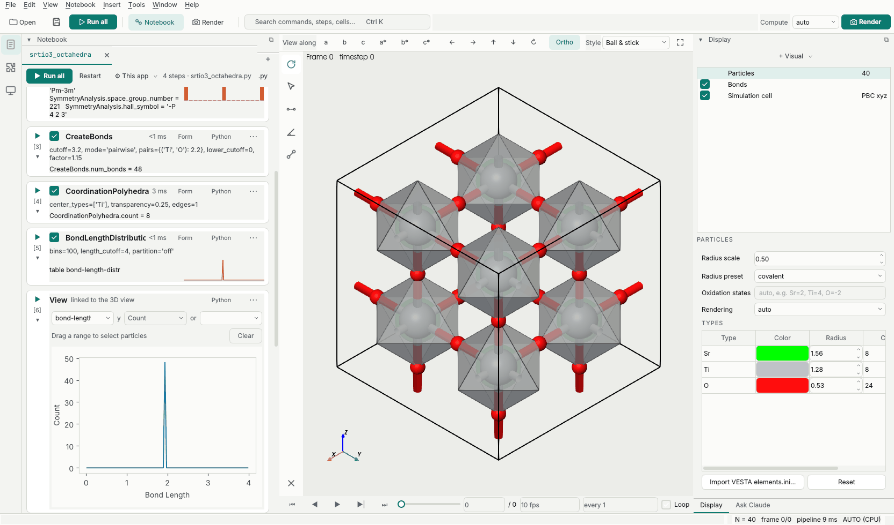

# Tutorial 2: a crystal structure figure

Cubic SrTiO3 from a VASP POSCAR: its space group and Wyckoff sites, Ti-O bonds and TiO6 octahedra,
the bond-length distribution, and a figure for a paper. The finished notebook is
[`examples/notebooks/srtio3_octahedra.py`](https://github.com/frssp/ewald/blob/main/examples/notebooks/srtio3_octahedra.py).



## 1. Open and find the symmetry

File › Open example › `POSCAR.SrTiO3` (a 2x2x2 supercell, 40 atoms). The toolbar above the view
has VESTA's directions: *a*, *b*, *c* look along the cell vectors, *a\**, *b\**, *c\** along the
reciprocal ones, and the arrows rotate in 90° steps. Then add a step (`SymmetryAnalysis` uses
spglib, which the `[gui]` install leaves out: `pip install "ewald[symmetry]"` first, or
`pip install spglib`):

```python
pipe.add(SymmetryAnalysis(symprec=0.01))
```

The step lists the space group among its outputs. To print it:

```python
data = pipe.compute(0)
a = data.attributes
print(a["SymmetryAnalysis.space_group"], a["SymmetryAnalysis.space_group_number"], a["SymmetryAnalysis.wyckoff_sites"])
```

`Pm-3m 221 Sr 1a, Ti 1b, O 3c`. The step also gives every atom a `Wyckoff Position` and a
`Site Symmetry` property; `symprec` is the distance tolerance in Å, so a relaxed DFT cell with small
distortions can still be recognized.

## 2. Bonds and octahedra

The GUI draws automatic bonds for display (Ti-O and Sr-O here). For the octahedra we want Ti-O
bonds only, as data, so add them explicitly and build polyhedra on Ti; the automatic bonds give way
to the step's bonds:

```python
pipe.add(CreateBonds(mode="pairwise", pairs={("Ti", "O"): 2.2}))
pipe.add(CoordinationPolyhedra(center_types=["Ti"], transparency=0.25))
```

`mode="covalent"` would bond every pair shorter than 1.15 times the sum of covalent radii instead,
as VESTA does. To see whole octahedra on the cell faces, tick *Boundary* on the Cell card of
the View tab (below the 3D view) and set the range to -0.05 to 1.05: the periodic images are drawn and the bonds
and polyhedra completed, without changing the data.

## 3. Bond lengths

```python
pipe.add(BondLengthDistribution())
show(pipe, table="bond-length-distr")
```

One sharp peak at about 1.95 Å, half the lattice constant. On a distorted structure the peak splits;
`BondLengthDistribution(partition="bond_type")` gives one column per bond type, and dragging over a
peak selects the atoms of those bonds.

## 4. The figure

The **Render** button opens the render workspace: renderer, size presets for journal columns,
resolution, background and overlays, with a preview. Its *Python for this figure* panel shows the
call that makes the same image, so the figure can live in the notebook:

```python
pipe.render("srtio3.png", size=(1200, 900), direction=(3, 1.4, 1), theme="VESTA", radius_scale=0.5,
            boundary=(-0.05, 1.05), type_legend=True, renderer="raytrace", quality="draft")
```

`quality="draft"` renders quickly while you adjust things; leave it out for the final figure
(`"publication"`, the default: 16 rays per pixel, ambient occlusion and shadows). `renderer="vector"`
with a `.svg` or `.pdf` name writes a vector figure with real circles and editable text. Themes,
radius presets (covalent, ionic with oxidation states, van der Waals) and overlays are in
[Rendering figures](../rendering.md).

Next: [Tutorial 3: a trajectory](trajectory.md).
