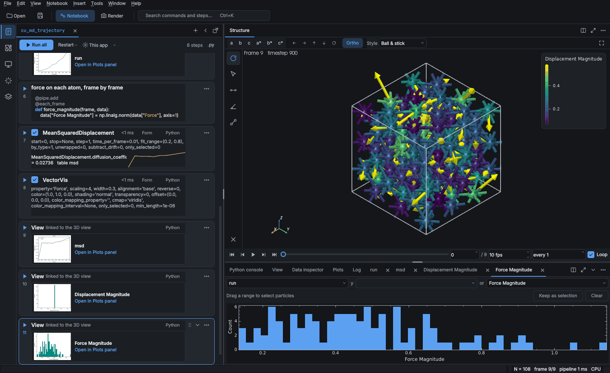

# Tutorial 3: a trajectory

Ten frames of fcc copper from an MD run with forces, in extended XYZ: how far each atom moved, the
mean squared displacement, force arrows, and choosing frames from a plot. The finished notebook is
[`examples/notebooks/cu_md_trajectory.py`](https://github.com/frssp/ewald/blob/main/examples/notebooks/cu_md_trajectory.py).



## 1. Open

File › Open example › `Cu_md.extxyz`. The timeline has 10 frames; play them with the ▶ button
under the view or drag the slider. Every step you add runs again on the frame you move to.

## 2. Displacements

```python
pipe.add(CalculateDisplacements(reference_frame=0))
pipe.add(ColorCoding("Displacement Magnitude", cmap="viridis"))
```

`CalculateDisplacements` adds `Displacement` (a vector) and `Displacement Magnitude` relative to
frame 0, using the minimum image so atoms that crossed the periodic boundary are not counted as
having jumped across the cell. `ColorCoding` colors by it and draws a color bar. Move to the last
frame to see which atoms went furthest. A histogram of the same property:

```python
show(pipe, histogram="Displacement Magnitude")
```

## 3. Energy and forces, frame by frame

Your own analysis is a Python function under `@pipe.add`. One that needs the whole run reads it
once with `@all_frames`; here the energy of every frame (from the file) and the largest
displacement so far, as one table:

```python
@pipe.add
@all_frames
def run_summary(frames, data):
    data.tables["run"] = {
        "Timestep": np.array([d.attributes["Timestep"] for d in frames]),
        "Energy": np.array([d.attributes["Energy"] for d in frames]),
        "Max displacement": np.array([d["Displacement Magnitude"].max() for d in frames]),
    }

show(pipe, table="run", y="Energy")
```

`frames` gives each frame with the steps above already applied, so `Displacement Magnitude` is
there. The first column `Timestep` makes the table a time series: a marker follows the current
frame and a click on the curve goes to that frame; pick `Max displacement` under *y* to see the
other column. The step does not run again during playback, only when a step above it changes.

A function that works on one frame at a time is `@each_frame` (the `frame` number and that frame's
`data`), here the size of the force on each atom as a new property:

```python
@pipe.add
@each_frame
def force_magnitude(frame, data):
    data["Force Magnitude"] = np.linalg.norm(data["Force"], axis=1)

show(pipe, histogram="Force Magnitude")
```

The histogram is drawn again at every frame. `Force Magnitude` is a property like any other, so
`ColorCoding("Force Magnitude")` or `paint(data, "Force Magnitude > 1", "red")` work on it too.

## 4. Mean squared displacement

```python
pipe.add(MeanSquaredDisplacement(time_per_frame=0.01))
show(pipe, table="msd")
```

The `msd` table has the MSD against time (here in ps, from `time_per_frame`), one more column
per element when there are several, and `MSD fit`, a straight line over the middle of the run whose
slope gives the diffusion coefficient (attribute `MeanSquaredDisplacement.diffusion_coefficient`,
in Ų/ps). Ten frames of a solid are too short for a meaningful number; [Reproducing
papers](../papers.md) does the same on published AIMD runs of Li conductors and compares with the
papers.

The MSD view is a per-frame plot. Dragging over a time range selects those frames: they are marked
on the timeline and playback steps through them only. Clicking a point jumps to that frame. The
same works on the `Steps` table of a LAMMPS or VASP run, so you can, for example, select the
frames where the temperature is above some value (Shift+drag a box).

## 5. Force arrows

```python
pipe.add(VectorVis(property="Force", scaling=4.0))
```

draws an arrow per atom, `scaling` Å per eV/Å. Any vector property works the same way
(`Displacement`, `Velocity`, `Magnetic Moment`).

## 6. A movie

The render workspace writes movies too (MP4 uses the ffmpeg that comes with ewald; GIF
needs nothing), or from a cell:

```python
from ewald.render import render_animation
render_animation(pipe, "cu_md.gif", fps=5, text="frame [Frame]")
```

What next: [Modifiers](../modifiers.md) lists every analysis, [Plugins](../../plugins/index.md)
shows how to add your own as a step, and [Python scripting](../scripting.md) covers the pipeline API
in more depth.
