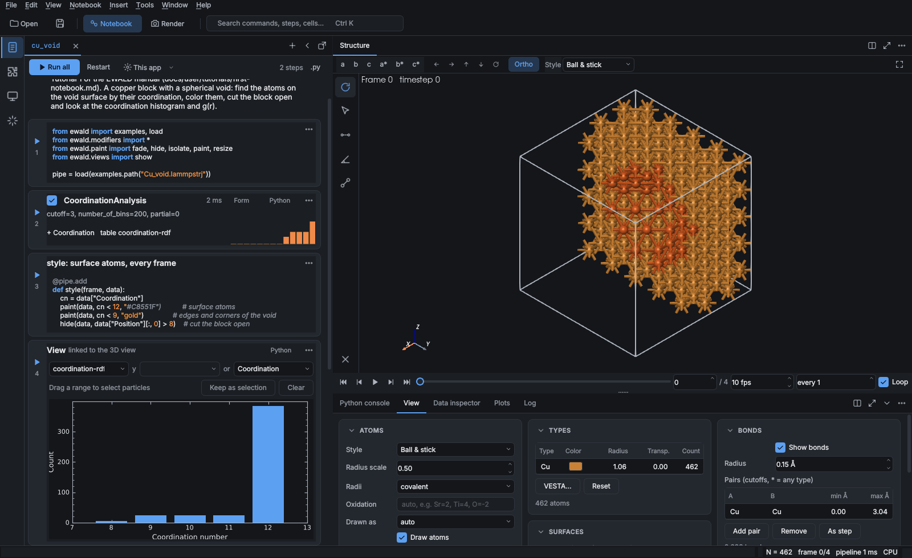

# Summary

Computational materials researchers spend much of their time between a simulation and a figure:
opening a trajectory from a molecular dynamics (MD) or density functional theory (DFT) run,
looking at it, computing structural or dynamical descriptors, and drawing the result for a paper.
EWALD (Extensible Workbench for Atomic Lattices & Dynamics) is an open-source Python package and
desktop application for this work. It reads the outputs of VASP [@Kresse1996], LAMMPS
[@Thompson2022] and the formats supported by ASE [@Larsen2017] and MDAnalysis
[@MichaudAgrawal2011], applies a pipeline of analysis steps (modifiers) such as common neighbor
analysis, polyhedral template matching, Voronoi tessellation, radial distribution functions and
mean squared displacements, and renders the result interactively, with a built-in ray tracer, or as
vector graphics. Its working unit is a notebook: every step is a Python cell next to a live 3D
view, and the notebook is saved as a plain Python script that reruns without the graphical
interface. An AI assistant built into the application drives the same notebook API, so what it
does is recorded as ordinary cells the user can read, edit and rerun.

# Statement of need

A typical analysis of a VASP or LAMMPS run today involves several tools: a viewer to look at the
structure, scripts to compute quantities, and another program to draw publication figures. The
steps taken in the viewer are rarely written down, which makes the final figure hard to reproduce.
EWALD addresses this by making the record of an analysis and the interactive session the same
object. Clicking a menu entry, writing a cell, or asking the assistant all add a cell such as
`pipe.add(CommonNeighborAnalysis())` to the notebook; the notebook runs headless on a cluster
node, on the CPU or an NVIDIA GPU, and produces the same numbers and images.

EWALD is aimed at researchers who run periodic DFT and classical or machine-learned MD and who need
crystallographic and dynamical analysis in one place: structures, volumetric data (charge
densities), electronic densities of states and band structures, nudged elastic band paths, ion
transport, and trajectories that may still be growing on a remote machine. It is also meant for
teaching, since a notebook shows both the picture and the code that produced it.

# State of the field

OVITO [@Stukowski2010] is the reference tool for materials MD analysis and has inspired EWALD's
pipeline model and property names. Its open-source edition provides the analysis library, but
the Python scripting inside the desktop application, several analysis modifiers and the
high-quality renderers are part of the commercial OVITO Pro. VMD [@Humphrey1996] is widely used for
large trajectories but targets biomolecular systems and is distributed under a license that
restricts redistribution of its code. VESTA [@Momma2011] is the common choice for crystal structures
and volumetric data but has no trajectory analysis or scripting. The ASE GUI [@Larsen2017], nglview
[@Nguyen2018] and chemiscope [@Fraux2020] are lightweight and Python native but offer limited
analysis and rendering. Libraries such as freud [@Ramasubramani2020], pymatgen [@Ong2013],
MDAnalysis [@MichaudAgrawal2011] and MDTraj [@McGibbon2015] provide analyses without an interactive view.
Language-model agents with domain tools plan and run chemistry and simulation tasks
[@Bran2024; @Boiko2023; @Campbell2025], and agents that act by writing code do better than
agents limited to fixed tool calls [@Wang2024]; EWALD applies both ideas to analysis and
visualization, with notebook cells as the assistant's only way to act. EWALD combines an
OVITO-style analysis pipeline, VESTA-style crystal and volumetric display, a notebook in the spirit
of Jupyter [@Kluyver2016] and publication rendering under the MIT license, so that the complete
workflow can be shared, inspected and extended.

# Software design

The core is a lazy, frame-cached pipeline: `load(path)` returns a `Pipeline` whose source reader
indexes frame offsets once and parses frames on demand, and each modifier receives a
`DataCollection` and returns a new one without mutating cached arrays. Native readers for large
text trajectories (LAMMPS dump, extended XYZ, XDATCAR) use a Numba [@Lam2015] parser and give
random access to any frame of files with millions of atoms or thousands of frames; other formats are delegated to
ASE, MDAnalysis and h5py. Compute kernels are written once against an array backend (NumPy or
CuPy [@Okuta2017]), so the CPU path exercised in tests is the same code that runs on the GPU.

Analyses where a verified implementation exists are ported rather than rewritten. The common
neighbor analysis [@Honeycutt1987], polyhedral template matching [@Larsen2016], Voronoi analysis
(voro++ [@Rycroft2009]) and centrosymmetry [@Kelchner1998] implementations are C++ ports of OVITO's source, which is
available under the MIT license, and are tested against reference results computed with OVITO and
freud. Symmetry uses spglib [@Togo2024].

All renderers draw a renderer-neutral scene description made of spheres, cylinders, meshes and
overlays: an interactive VTK/PyVista [@Schroeder2006; @Sullivan2019] viewport that favours frame
rate (level of detail, sphere impostors for millions of atoms, a legacy OpenGL path for remote X
sessions), a Numba ray tracer that favours quality for publication images and movies, and a
Matplotlib-based [@Hunter2007] vector renderer for SVG and PDF figures. The desktop application (PySide6) is
built on the notebook model: notebooks are top-level tabs, each step cell carries a parameter form
generated from the modifier's constructor signature, and view cells hold plots linked to the 3D
selection (\autoref{fig:notebook}). Notebooks can also run in a separate Jupyter kernel.

The AI assistant works with several model providers and exposes read-only tools (structure
descriptors, current view, atom colors) and tools that insert, edit and run notebook cells; it
cannot change data in any other way. The same tools are offered to external agents through a
Model Context Protocol server. Notebooks, bundles (`.ewd`) and text inside structure files
cannot execute code, or instruct the assistant to execute it, until the user trusts them.
File formats, modifiers, visual elements, color maps, themes, panels and AI providers are plugins
declared by a manifest; the built-in formats are registered the same way, and domain packages for
phonopy, PLUMED and AiiDA are maintained as separate first-party plugins.

# Research impact statement

EWALD ships scripts that reproduce published analyses from openly available data with EWALD's
modifiers and compare the numbers with the published or reference values, for example lithium
diffusion in the Li$_6$PS$_5$Cl argyrodite from ab initio MD [@Morgan2021; @McCluskey2025]. The data
are downloaded on demand and checked against pinned checksums, so these scripts double as
reproducible reference analyses. Reader benchmarks against ASE, OVITO, MDAnalysis and chemfiles
are included in the repository. The test suite (more than 1,300 tests) covers the readers,
modifiers against OVITO and freud references, image regression for all renderers, the graphical
interface under a virtual display, and the tutorial notebooks. TODO: list publications, groups
or courses using EWALD once available.

# AI usage disclosure

Generative AI was used extensively. Most of the source code, tests and documentation were written
by Claude Code (Anthropic, Claude Opus models) working from the author's design decisions and
reviews; the author defined the scope, architecture, user interface concept, conventions and
acceptance criteria, reviewed the changes and tested the application on Windows and Linux; these
design decisions, with their dates and reasons, are recorded in the repository
(`docs/developer/decisions.md`). The
correctness of AI-written analysis code was checked against independent implementations
(OVITO, freud, kinisi and published values) stored as reference data, rendering against reference
images, and the user interface by automated tests and manual use. This paper was drafted with the
same assistant and edited by the author.

# Acknowledgements

We thank the developers of OVITO for releasing its source under the MIT license, and the
developers of ASE, freud, voro++, PTM, VTK, PyVista, Numba, spglib and MDAnalysis, on which EWALD
builds. TODO: funding sources (or state that there was no specific funding) and a conflict of
interest statement.

# References
